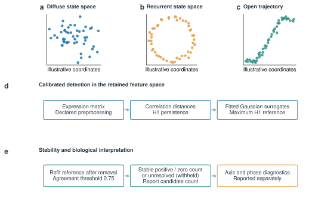
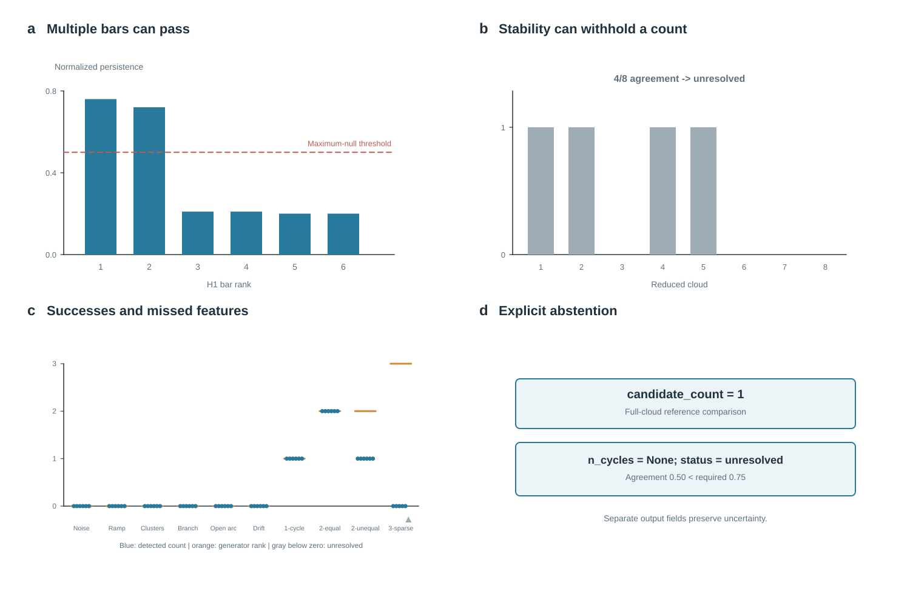
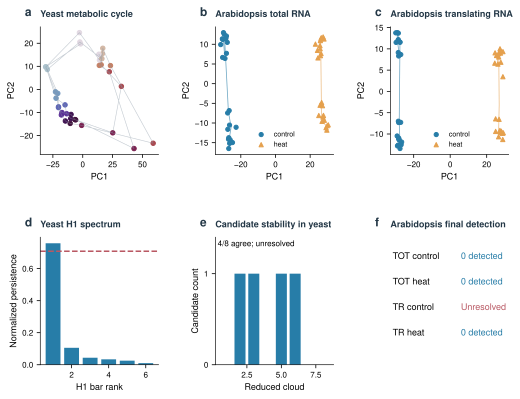
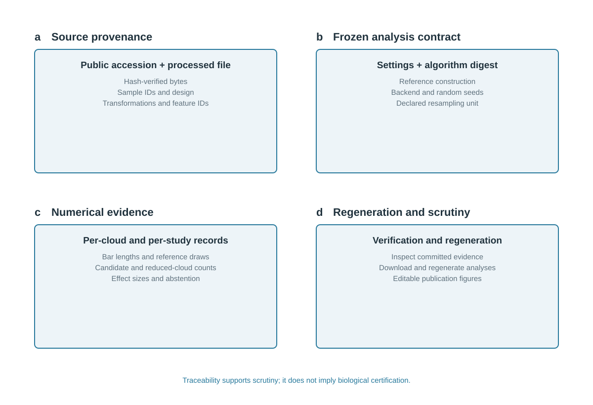
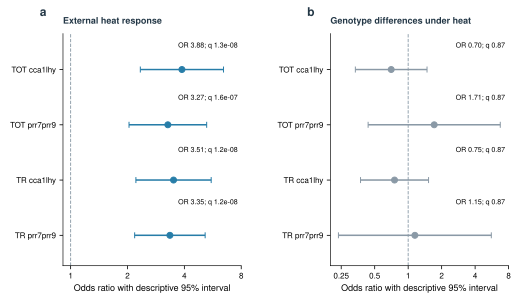

# OmicsTopology

Python tools for persistent homology and design-associated geometry in omics
state spaces. The current protocol detects **H1 features under a specified
reference model**; it does not count biological oscillators or establish
independent latent coordinates.

## Manuscript main figures (final, editable)

These six figures are the current main-figure set for the manuscript. Each preview is vector-based; select **PDF** for an editable vector PDF or **SVG source** to edit the original vector artwork. The `v2_figure*.svg` files below remain protocol/documentation figures and are **not** the manuscript's Figure 1-6 numbering.

The SVG/PDF files are editable vector reconstructions of the manuscript's embedded figure panels. Because the draft does not include the original vector sources, verify unlabelled bar endpoints and confidence-interval limits against the final analysis tables before submission.

### Figure 1. Software logic architecture



Separates calibrated H1 detection, design-axis diagnostics, and numerical provenance.

[Editable PDF](docs/figures/paper_figure1.pdf) · [SVG source](docs/figures/paper_figure1.svg)

### Figure 2. Calibrated detection and explicit abstention



Shows balanced-loop detection, resampling instability, undercounting, and withheld results.

[Editable PDF](docs/figures/paper_figure2.pdf) · [SVG source](docs/figures/paper_figure2.svg)

### Figure 3. Axis-aware phase diagnostics



Separates coding-invariant treatment distances from circular phase modulation and gene-specific dispersion.

[Editable PDF](docs/figures/paper_figure3.pdf) · [SVG source](docs/figures/paper_figure3.svg)

### Figure 4. Numerical provenance and reproducibility



Connects public inputs and frozen settings to scored records and regeneration.

[Editable PDF](docs/figures/paper_figure4.pdf) · [SVG source](docs/figures/paper_figure4.svg)

### Figure 5. External source evaluation and matched ordering comparison


Shows cyclic-succession scores, H1 walk coverage, and time-associated geometry across seven matrices.

[Editable PDF](docs/figures/paper_figure5.pdf) · [SVG source](docs/figures/paper_figure5.svg)

### Figure 6. Cross-experiment evidence for a heat-program association



Phase-difference candidates are enriched for external heat responses, while clock-genotype specificity remains unsupported.

[Editable PDF](docs/figures/paper_figure6.pdf) · [SVG source](docs/figures/paper_figure6.svg)


## Software overview diagrams


Conceptual comparison of state-space geometries. This illustration does not
establish the number of biological oscillators in an observed dataset.


## Install

```bash
pip install 'omictopo[fast] @ git+https://github.com/omixcore/OmicsTopology.git@fix/validated-topology-protocol'
```

Python ≥3.9, NumPy and SciPy are required. The v2 counting protocol pins ripser
and fails explicitly if it is unavailable. Install `[dev]` for the complete
test and reproduction environment, including optional baseline dependencies.

## Detect H1 features and report uncertainty

```python
from omictopo import analyse, summarise

# X: samples × features. Units may identify repeated subjects or trees.
result = analyse(X, axis=phase, period=24, backend='ripser', seed=0,
                 units=subject_ids)
print(summarise(result))
result['candidate_count']       # bars passing the maximum-surrogate test
result['n_cycles']              # stable detected count, or None on abstention
result['stability']             # counts and agreement across reduced clouds
result['design_association']    # separate Mantel effect; p omitted by default
```

Every observed bar is compared with a Gaussian surrogate **maximum** H1
statistic. Surrogate draws are reconstructed in feature space and pass through
the same standardisation and distance calculation as the observations. Each
subsample refits its own surrogate distribution. A two-loop result is not
rejected just because its two bars have similar lengths.

A stable count of zero means **no H1 features detected under this analysis**;
it is not proof that a biological rhythm is absent. Resampling agreement is
robustness, not posterior count confidence or nominal Betti-number coverage.
`units` retains complete independent units during topology subsampling. Without
units, row subsampling is a geometric sensitivity check. The design Mantel
statistic never decides how many features are reported.

## Describe a second axis

```python
from omictopo.axes import axis_geometry

record = axis_geometry(X, clock_hours, treatment,
                       period1=24, axis2_kind='categorical', units=subject_ids)
record['axis_effect']
record['phase_or_shape']        # circular offsets, reliable fits and residuals
record['matched']               # separate intervals for ratio and difference
record['cyclic_evidence']       # second cycle is not established by Mantel r
```

Categories use equal distances between different labels, rather than an
arbitrary ordering on a circle. Harmonic fits include an intercept. Phase
residuals wrap on the circle, and gene coherence measures agreement across
genes. Mean block offsets alone are not evidence for a common shift. Optional
phase uncertainty resamples whole supplied units or rows within fit blocks.
Raw-row intervals are descriptive when observations are temporally dependent.

Mantel permutations now exchange sample labels by simultaneously permuting
matrix rows and columns. Supply `permutation='samples'` only when justified;
`permutation_strata` restricts exchanges within a declared block. A degenerate
scheme returns no p-value. Never treat a significant axis effect as evidence
for another independent loop.

## Evidence and limitations

Read [docs/results.md](docs/results.md) for the frozen v2 validation and fresh
public-source analyses. Validation seeds are separate from development seeds;
the configuration and algorithm hash are fixed before scoring. This is an
internal frozen plan, not an externally registered or independently conducted
study. GSE3431 is a new source study held out from parameter fitting; it remains
one retrospective continuous-culture experiment.

The tests include equal-strength and unequal-strength double loops, a sparse
three-loop manifold, Gaussian noise, an open arc, drift, clusters and a branch.
Undercounts and unresolved real cases are reported alongside successes.

Version-1 JSON records remain unchanged in `benchmark/`. Their old protocol
and phase classifier are available explicitly as `omictopo.legacy_protocol`
and `omictopo.legacy_axes` to reproduce historical records. They are not v2
validation. See [docs/migration_v2.md](docs/migration_v2.md).

### Protocol-specific v2 validation figures (separate from manuscript Figure 1-6)


These protocol-specific figures document the v2 software validation route. They are retained separately from the six manuscript main figures above; successful cases, undercounts and unresolved cases are all shown.


The GSE3431 candidate is unresolved under resampling.


Treatment association does not establish an independent cycle or cycle loss.

## Historical figure gallery (v1)

The original figures below remain available for inspecting the earlier analyses.
Their numerical panels use v1 records and methods, not the corrected v2 protocol.
Read [the historical results](docs/results_v1.md) alongside the
[current evidence and limitations](docs/results.md). These panels should not be
used as current validation or as evidence for counting biological oscillators.

### Circadian geometry and replicate sensitivity


### Benchmark trajectories and reference comparisons


### Label withholding, sample size and baseline comparisons


## Reproduce

```bash
pip install -e '.[dev]'
python reproduce/reproduce_v2.py              # tests, integrity, v2 smoke check
python reproduce/reproduce_v2.py --synthetic  # rerun the frozen 60-cloud study
python reproduce/reproduce_v2.py --real       # download, hash-check, reanalyse sources
```

The real route downloads processed expression matrices for GSE3431 and
GSE158444; raw files are not redistributed. Source and derived-record hashes,
all settings, sample identifiers and environment metadata accompany results.
The real two-fraction comparison is one study, not two independent replications.
GitHub CI executes both historical record verification and a v2 smoke check.
A [container recipe](reproduce/Dockerfile) and a reference environment are
provided. A fresh real-data run is different from checking committed summaries.

## General two-condition workflow

The existing `run_states` and `omictopo run` workflow generates diagrams,
barcodes, Betti curves and permutation comparisons between groups. It uses a
shared PCA embedding, unlike the full-feature distance geometry of v2 counting.
These outputs must not be conflated. Full H2 persistence requires ripser; the
built-in implementation does not construct tetrahedra and can truncate at its
simplex budget.

[API](docs/api.md) · [Protocol](docs/protocol.md) ·
[Validation](docs/results.md) · [MIT license](LICENSE)
