# OmicsTopology

Python tools for persistent homology and design-associated geometry in omics
state spaces. The current protocol detects **H1 features under a specified
reference model**; it does not count biological oscillators or establish
independent latent coordinates.

## Manuscript figures

The six main figures and eleven supplementary figures below are the current submission set. Each figure is available as a PNG preview, editable PDF, and SVG source in `docs/figures/`.

### Main figures

#### Figure 1. Concept and analysis workflow

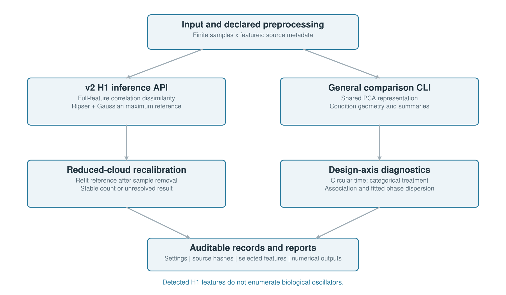

Separates calibrated H1 detection, design-axis diagnostics, and phase analysis; schematic panels are identified as conceptual.

[Editable PDF](docs/figures/paper_figure1.pdf) · [SVG source](docs/figures/paper_figure1.svg)

#### Figure 2. Calibration and recovery limits

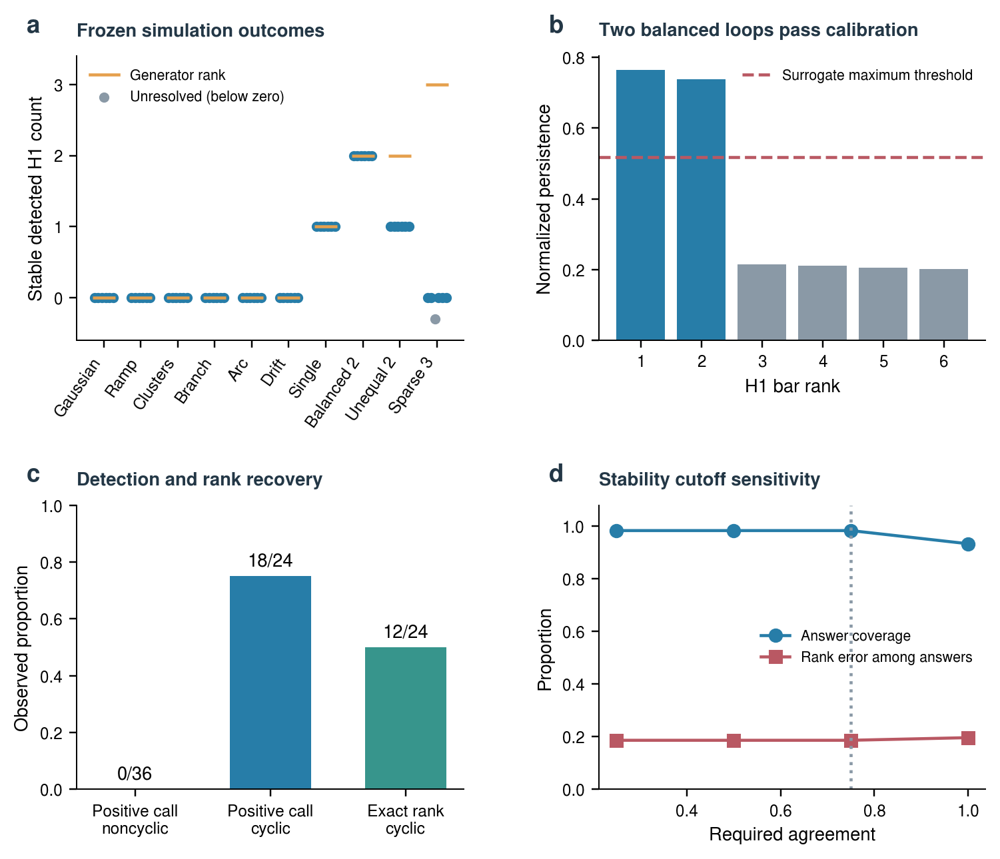

Shows the frozen v2 calibration, recovery behavior, and unresolved outcomes.

[Editable PDF](docs/figures/paper_figure2.pdf) · [SVG source](docs/figures/paper_figure2.svg)

#### Figure 3. Transcriptomic geometry and calibrated detection

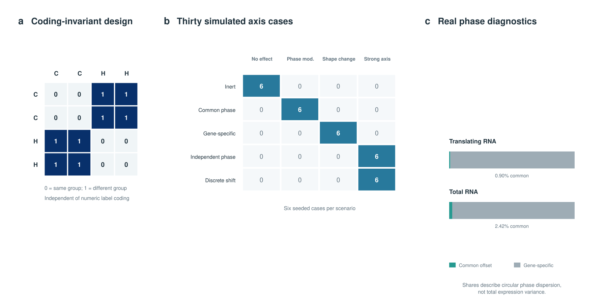

Displays public-source geometry and the resulting calibrated H1 decisions.

[Editable PDF](docs/figures/paper_figure3.pdf) · [SVG source](docs/figures/paper_figure3.svg)

#### Figure 4. External ordering and sample coverage

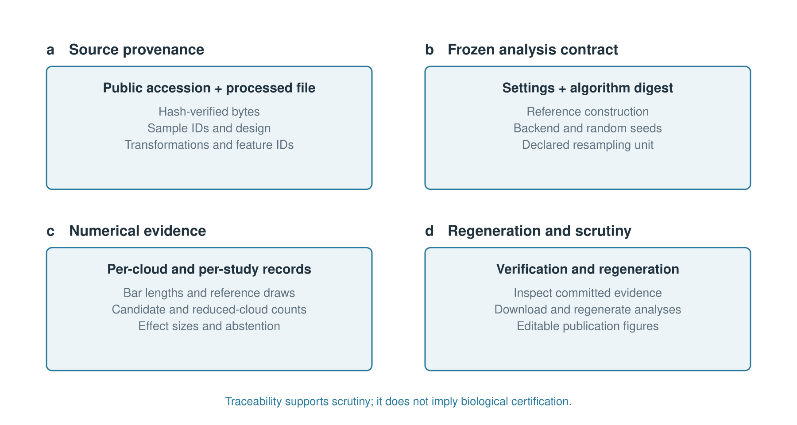

Compares seven ordering methods and reports unique-sample coverage and common-support scores.

[Editable PDF](docs/figures/paper_figure4.pdf) · [SVG source](docs/figures/paper_figure4.svg)

#### Figure 5. Axis effects and circular phase

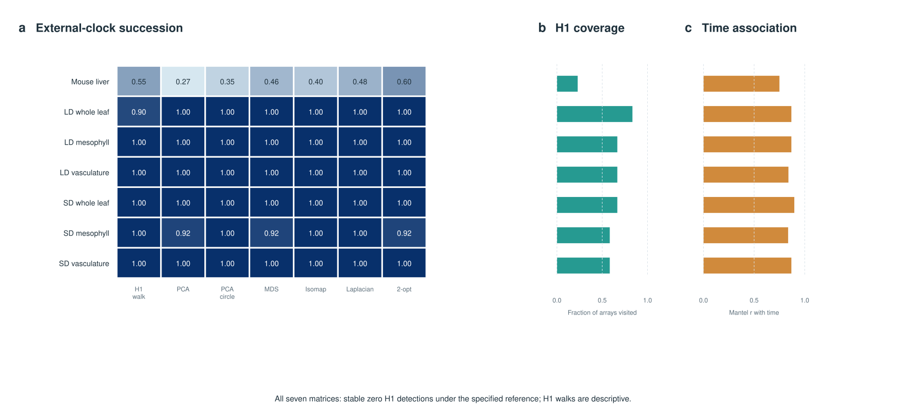

Reports treatment-axis effects and circular phase diagnostics.

[Editable PDF](docs/figures/paper_figure5.pdf) · [SVG source](docs/figures/paper_figure5.svg)

#### Figure 6. Cross-experiment heat-response enrichment

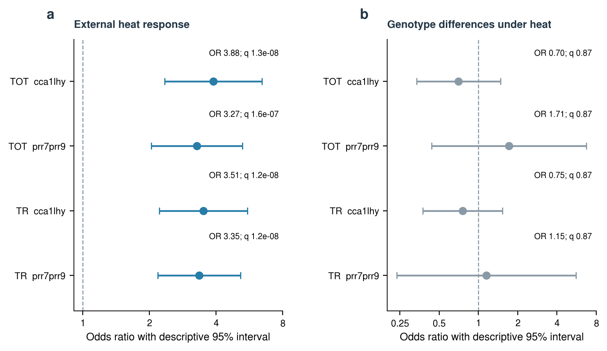

Shows phase-difference candidate enrichment and its limits for clock-specific interpretation.

[Editable PDF](docs/figures/paper_figure6.pdf) · [SVG source](docs/figures/paper_figure6.svg)

[Combined main-figure PDF](docs/figures/manuscript_main_figures.pdf)

### Supplementary figures

- Figure S1: [PNG](docs/figures/supplementary/paper_figureS1.png) · [PDF](docs/figures/supplementary/paper_figureS1.pdf) · [SVG](docs/figures/supplementary/paper_figureS1.svg)
- Figure S2: [PNG](docs/figures/supplementary/paper_figureS2.png) · [PDF](docs/figures/supplementary/paper_figureS2.pdf) · [SVG](docs/figures/supplementary/paper_figureS2.svg)
- Figure S3: [PNG](docs/figures/supplementary/paper_figureS3.png) · [PDF](docs/figures/supplementary/paper_figureS3.pdf) · [SVG](docs/figures/supplementary/paper_figureS3.svg)
- Figure S4: [PNG](docs/figures/supplementary/paper_figureS4.png) · [PDF](docs/figures/supplementary/paper_figureS4.pdf) · [SVG](docs/figures/supplementary/paper_figureS4.svg)
- Figure S5: [PNG](docs/figures/supplementary/paper_figureS5.png) · [PDF](docs/figures/supplementary/paper_figureS5.pdf) · [SVG](docs/figures/supplementary/paper_figureS5.svg)
- Figure S6: [PNG](docs/figures/supplementary/paper_figureS6.png) · [PDF](docs/figures/supplementary/paper_figureS6.pdf) · [SVG](docs/figures/supplementary/paper_figureS6.svg)
- Figure S7: [PNG](docs/figures/supplementary/paper_figureS7.png) · [PDF](docs/figures/supplementary/paper_figureS7.pdf) · [SVG](docs/figures/supplementary/paper_figureS7.svg)
- Figure S8: [PNG](docs/figures/supplementary/paper_figureS8.png) · [PDF](docs/figures/supplementary/paper_figureS8.pdf) · [SVG](docs/figures/supplementary/paper_figureS8.svg)
- Figure S9: [PNG](docs/figures/supplementary/paper_figureS9.png) · [PDF](docs/figures/supplementary/paper_figureS9.pdf) · [SVG](docs/figures/supplementary/paper_figureS9.svg)
- Figure S10: [PNG](docs/figures/supplementary/paper_figureS10.png) · [PDF](docs/figures/supplementary/paper_figureS10.pdf) · [SVG](docs/figures/supplementary/paper_figureS10.svg)
- Figure S11: [PNG](docs/figures/supplementary/paper_figureS11.png) · [PDF](docs/figures/supplementary/paper_figureS11.pdf) · [SVG](docs/figures/supplementary/paper_figureS11.svg)

[Combined supplementary-figure PDF](docs/figures/manuscript_supplementary_figures.pdf)

## Manuscript code and data

**Manuscript:** *Calibrated Topology and Phase Diagnostics for Transcriptomic State Spaces*.

The publication-source revision is pinned to [`8b21f89749be1106ea3633c15bd70b5a4d207f1b`](https://github.com/omixcore/OmicsTopology/tree/8b21f89749be1106ea3633c15bd70b5a4d207f1b); the frozen inference core is [`13b1955c8a01c56e2c10c5578c395cdbb09f84d1`](https://github.com/omixcore/OmicsTopology/tree/13b1955c8a01c56e2c10c5578c395cdbb09f84d1). The analysis code can be installed from the publication-source revision with:

```bash
pip install 'omictopo[fast] @ git+https://github.com/omixcore/OmicsTopology.git@8b21f89749be1106ea3633c15bd70b5a4d207f1b'
```

The public expression datasets are available from NCBI GEO: [GSE3431](https://www.ncbi.nlm.nih.gov/geo/query/acc.cgi?acc=GSE3431), [GSE158444](https://www.ncbi.nlm.nih.gov/geo/query/acc.cgi?acc=GSE158444), [GSE11923](https://www.ncbi.nlm.nih.gov/geo/query/acc.cgi?acc=GSE11923), [GSE50438](https://www.ncbi.nlm.nih.gov/geo/query/acc.cgi?acc=GSE50438), [GSE116004](https://www.ncbi.nlm.nih.gov/geo/query/acc.cgi?acc=GSE116004), [GSE138193](https://www.ncbi.nlm.nih.gov/geo/query/acc.cgi?acc=GSE138193), [GSE137732](https://www.ncbi.nlm.nih.gov/geo/query/acc.cgi?acc=GSE137732), and [GSE128739](https://www.ncbi.nlm.nih.gov/geo/query/acc.cgi?acc=GSE128739). Raw GEO files are not redistributed. The processed matrices, numerical records, rebuild scripts, and source-file SHA-256 checksums are included in the accompanying submission code/data bundle. A permanent archive DOI for that bundle is pending.

## Software overview diagrams

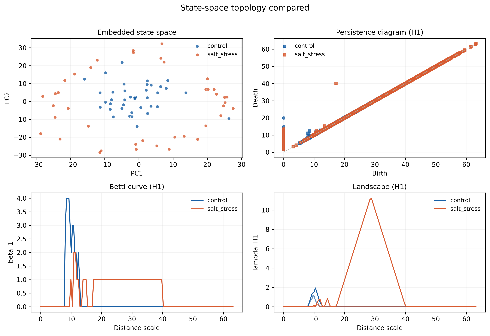

Conceptual comparison of state-space geometries. This illustration does not
establish the number of biological oscillators in an observed dataset.

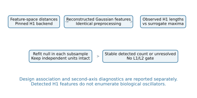

## Install

```bash
pip install 'omictopo[fast] @ git+https://github.com/omixcore/OmicsTopology.git@8b21f89749be1106ea3633c15bd70b5a4d207f1b'
```

Python ≥3.9, NumPy and SciPy are required. The v2 counting protocol pins ripser
and fails explicitly if it is unavailable. Install `[dev]` for the complete
test and reproduction environment, including optional baseline dependencies.

## Detect H1 features and report uncertainty

```python
from omictopo import analyse, summarise

# X: samples × features. Units may identify repeated subjects or trees.
result = analyse(X, axis=phase, period=24, backend='ripser', seed=0,
                 units=subject_ids)
print(summarise(result))
result['candidate_count']       # bars passing the maximum-surrogate test
result['n_cycles']              # stable detected count, or None on abstention
result['stability']             # counts and agreement across reduced clouds
result['design_association']    # separate Mantel effect; p omitted by default
```

Every observed bar is compared with a Gaussian surrogate **maximum** H1
statistic. Surrogate draws are reconstructed in feature space and pass through
the same standardisation and distance calculation as the observations. Each
subsample refits its own surrogate distribution. A two-loop result is not
rejected just because its two bars have similar lengths.

A stable count of zero means **no H1 features detected under this analysis**;
it is not proof that a biological rhythm is absent. Resampling agreement is
robustness, not posterior count confidence or nominal Betti-number coverage.
`units` retains complete independent units during topology subsampling. Without
units, row subsampling is a geometric sensitivity check. The design Mantel
statistic never decides how many features are reported.

## Describe a second axis

```python
from omictopo.axes import axis_geometry

record = axis_geometry(X, clock_hours, treatment,
                       period1=24, axis2_kind='categorical', units=subject_ids)
record['axis_effect']
record['phase_or_shape']        # circular offsets, reliable fits and residuals
record['matched']               # separate intervals for ratio and difference
record['cyclic_evidence']       # second cycle is not established by Mantel r
```

Categories use equal distances between different labels, rather than an
arbitrary ordering on a circle. Harmonic fits include an intercept. Phase
residuals wrap on the circle, and gene coherence measures agreement across
genes. Mean block offsets alone are not evidence for a common shift. Optional
phase uncertainty resamples whole supplied units or rows within fit blocks.
Raw-row intervals are descriptive when observations are temporally dependent.

Mantel permutations now exchange sample labels by simultaneously permuting
matrix rows and columns. Supply `permutation='samples'` only when justified;
`permutation_strata` restricts exchanges within a declared block. A degenerate
scheme returns no p-value. Never treat a significant axis effect as evidence
for another independent loop.

## Evidence and limitations

Read [docs/results.md](docs/results.md) for the frozen v2 validation and fresh
public-source analyses. Validation seeds are separate from development seeds;
the configuration and algorithm hash are fixed before scoring. This is an
internal frozen plan, not an externally registered or independently conducted
study. GSE3431 is a new source study held out from parameter fitting; it remains
one retrospective continuous-culture experiment.

The tests include equal-strength and unequal-strength double loops, a sparse
three-loop manifold, Gaussian noise, an open arc, drift, clusters and a branch.
Undercounts and unresolved real cases are reported alongside successes.

Version-1 JSON records remain unchanged in `benchmark/`. Their old protocol
and phase classifier are available explicitly as `omictopo.legacy_protocol`
and `omictopo.legacy_axes` to reproduce historical records. They are not v2
validation. See [docs/migration_v2.md](docs/migration_v2.md).

### Protocol-specific v2 validation figures (separate from manuscript Figure 1-6)

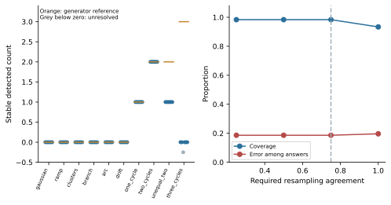

These protocol-specific figures document the v2 software validation route. They are retained separately from the six manuscript main figures above; successful cases, undercounts and unresolved cases are all shown.

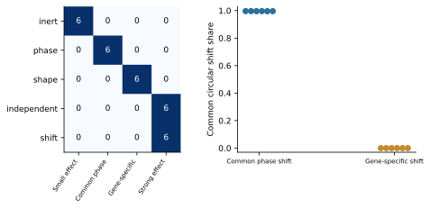

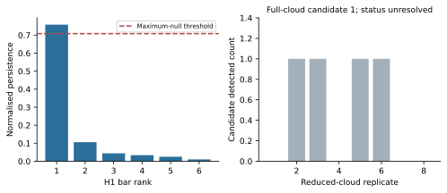

The GSE3431 candidate is unresolved under resampling.

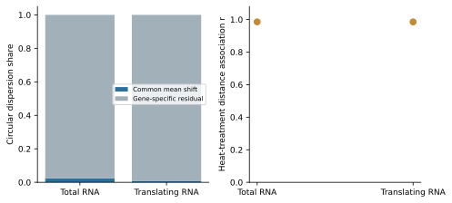

Treatment association does not establish an independent cycle or cycle loss.

## Historical figure gallery (v1)

The original figures below remain available for inspecting the earlier analyses.
Their numerical panels use v1 records and methods, not the corrected v2 protocol.
Read [the historical results](docs/results_v1.md) alongside the
[current evidence and limitations](docs/results.md). These panels should not be
used as current validation or as evidence for counting biological oscillators.

### Circadian geometry and replicate sensitivity

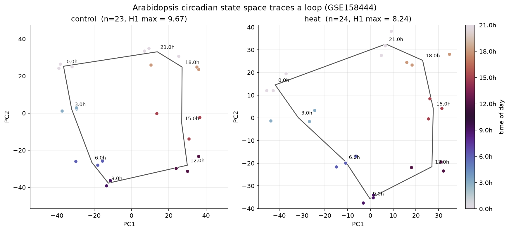

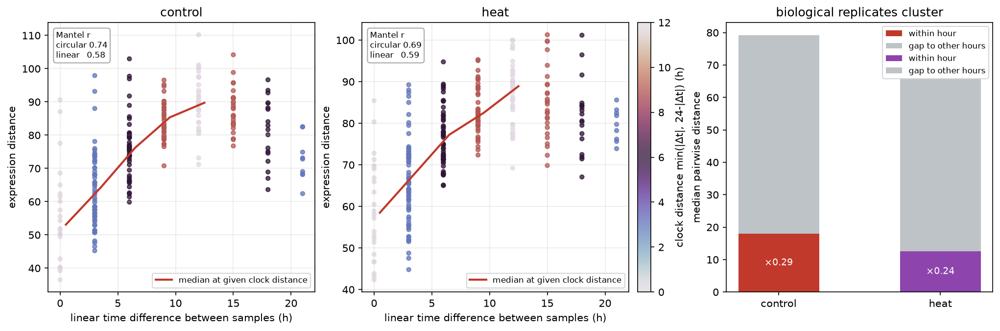

### Benchmark trajectories and reference comparisons

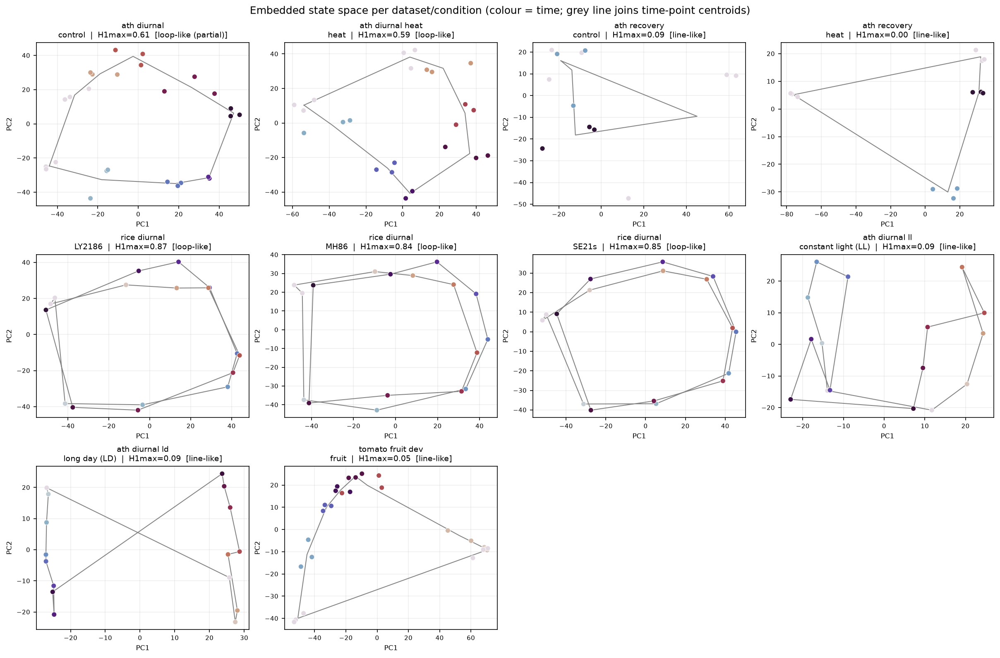

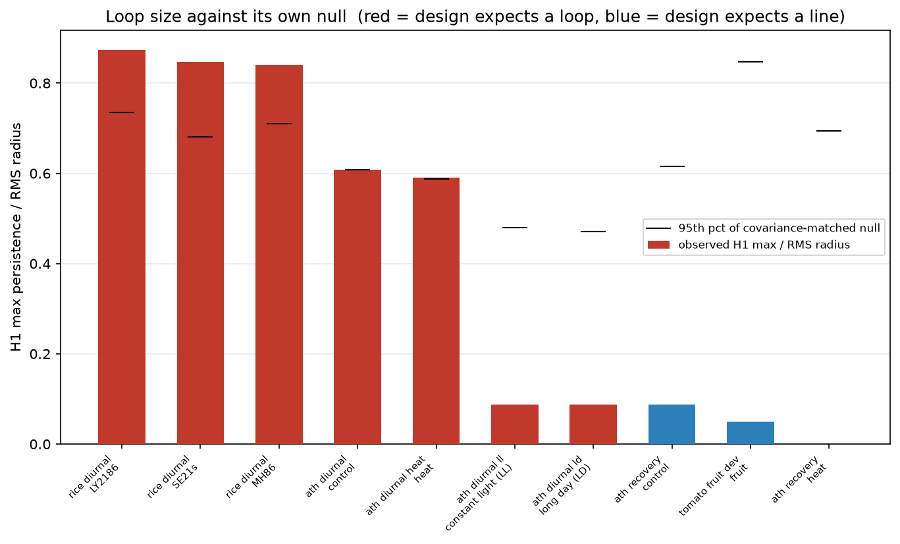

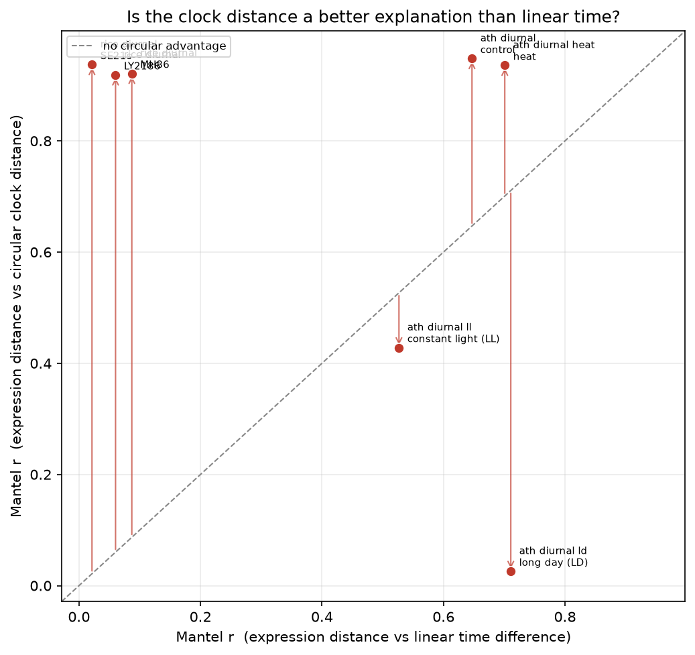

### Label withholding, sample size and baseline comparisons

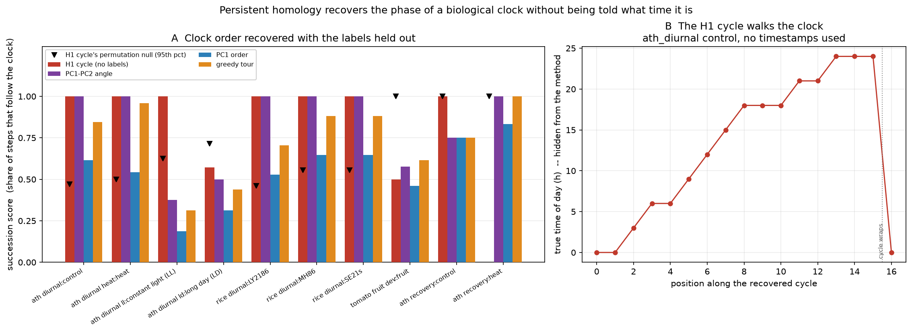

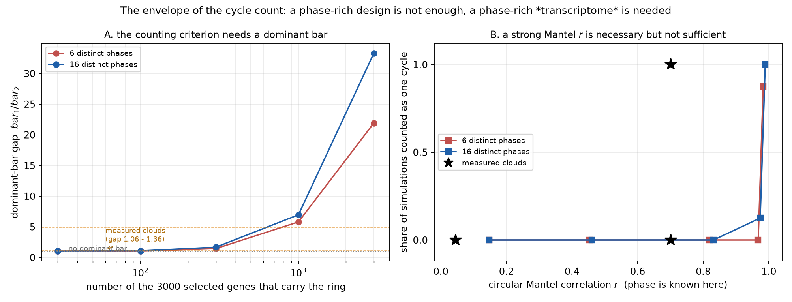

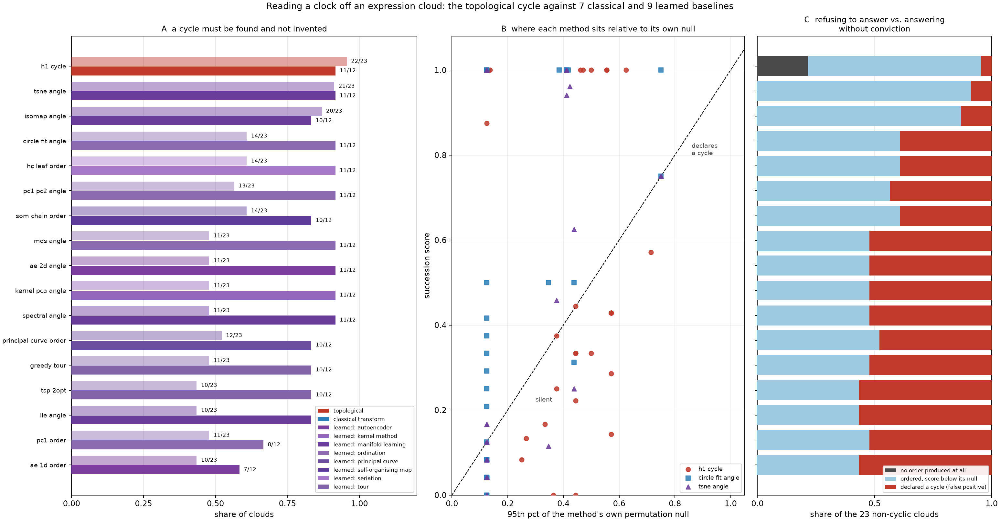

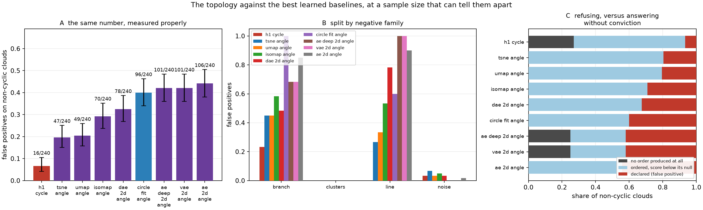

## Reproduce

```bash
pip install -e '.[dev]'
python reproduce/reproduce_v2.py              # tests, integrity, v2 smoke check
python reproduce/reproduce_v2.py --synthetic  # rerun the frozen 60-cloud study
python reproduce/reproduce_v2.py --real       # download, hash-check, reanalyse sources
```

The real route downloads processed expression matrices for GSE3431 and
GSE158444; raw files are not redistributed. Source and derived-record hashes,
all settings, sample identifiers and environment metadata accompany results.
The real two-fraction comparison is one study, not two independent replications.
GitHub CI executes both historical record verification and a v2 smoke check.
A [container recipe](reproduce/Dockerfile) and a reference environment are
provided. A fresh real-data run is different from checking committed summaries.

## General two-condition workflow

The existing `run_states` and `omictopo run` workflow generates diagrams,
barcodes, Betti curves and permutation comparisons between groups. It uses a
shared PCA embedding, unlike the full-feature distance geometry of v2 counting.
These outputs must not be conflated. Full H2 persistence requires ripser; the
built-in implementation does not construct tetrahedra and can truncate at its
simplex budget.

[API](docs/api.md) · [Protocol](docs/protocol.md) ·
[Validation](docs/results.md) · [MIT license](LICENSE)
