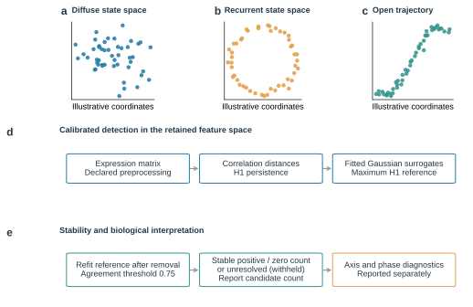
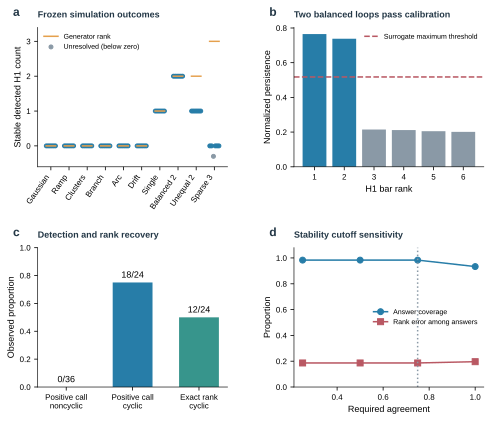
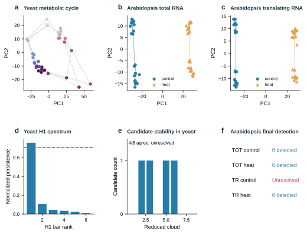
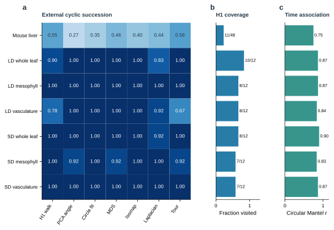
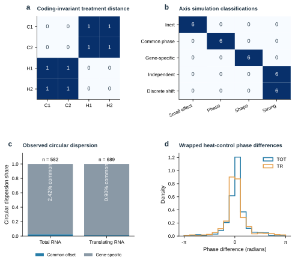
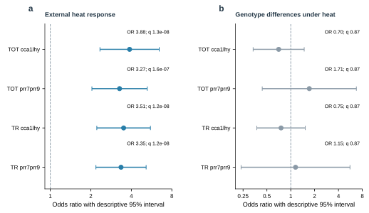

# OmicsTopology: calibrated topology and phase diagnostics for transcriptomic state spaces

Short title: OmicsTopology for transcriptomic state-space analysis

Xiaofeng Song1†, Pengyu Chen1† and Fei Liang2*

1 North Henan Medical University, Xinxiang, Henan, China

2 Key Laboratory of Tropical Fruit Biology of Ministry of Agriculture, South Subtropical Crops Research Institute, Chinese Academy of Tropical Agricultural Sciences, Zhanjiang, Guangdong, China

† These authors contributed equally.  * Corresponding author. Email: fyliangfei@163.com.

## Abstract

Persistent loops in transcriptomic sample spaces describe geometric recurrence, but do not by themselves identify rhythmic genes or biological oscillators. We developed OmicsTopology, an open-source workflow that separates first-homology detection under a fitted Gaussian reference, sensitivity to sample removal, association with experimental axes, and gene-level circular-phase diagnostics. In a frozen evaluation of 60 simulated clouds, the method recovered the reference counts in all six single-loop and six balanced double-loop cases and returned no positive detections among 36 noncyclic controls. It undercounted all six unequal-strength double loops, and five of six sparse triple-loop cases had stable zero detections. Public transcriptome reanalyses showed strong time-associated geometry but no stable positive loop detections under the selected settings. Matched ordering comparisons identified no general advantage for any method. In Arabidopsis, genes ranked by heat-control phase difference were enriched for published heat-responsive genes in a separate experiment (odds ratios, 3.27–3.88; adjusted q values, 1.22 × 10⁻⁸–1.57 × 10⁻⁷), while genotype-under-heat enrichment was unsupported. These results establish a reproducible hypothesis-generation workflow and quantify its failure modes; they do not validate an oscillator counter or a causal clock mechanism.

## Author Summary

We often look for rhythms in gene activity, but the shape traced by all samples together can also carry information. We developed OmicsTopology to examine whether transcriptomic samples form persistent loop-like patterns, how sensitive those patterns are to removing samples, and whether the observed geometry is associated with experimental conditions. We tested the workflow on simulated datasets with known structures and on public gene-expression studies. It detected balanced single and double loops in the simulated cases, but it missed or underestimated weak and sparsely sampled structures. In public datasets, time-related organization was often visible, yet the calibrated method did not identify stable positive loops under the chosen settings. A comparison with other sample-ordering methods showed no general advantage for topology-based ordering. A separate analysis found that genes with larger heat-versus-control phase differences were enriched for heat-responsive genes in another experiment, but this did not demonstrate clock-specific regulation. These results define where the approach is useful and where it can fail. OmicsTopology is intended as a reproducible tool for generating hypotheses, not as a counter of biological oscillators.

Keywords: persistent homology; transcriptomics; biological rhythms; surrogate calibration; circular statistics; reproducible analysis

## Introduction

Biological rhythms organize molecular processes across time, and transcriptomic measurements provide a high-dimensional view of their coordinated outputs. Analysis commonly begins by identifying genes with rhythmic expression, estimating phase and amplitude, or predicting the biological time associated with a sample. Experimental design, sampling density, biological replication, and waveform assumptions materially affect these tasks. [1] A complementary question concerns the geometry formed by entire samples: does a transcriptomic trajectory return toward previously occupied molecular states, and does this recurrence remain visible when examined across scales? Addressing that question requires a clear distinction between the behavior of individual transcripts and the shape of the collective measurement space.

Persistent homology describes topological features that appear and disappear as a scale parameter varies. [2, 3] Its first-homology summaries capture loop-like structure in a finite point cloud without requiring a predefined cyclic ordering. Stability theory relates perturbations of suitable inputs to changes in persistence diagrams, providing a mathematical foundation for interpreting multiscale structure. [4] More broadly, topological data analysis offers a language for examining shape in high-dimensional data. [5] Biological applications have illustrated how shape-based summaries can reveal structure that is difficult to express through a small collection of individual variables. [6] However, a stable mathematical summary and a validated biological interpretation remain separate achievements.

Existing rhythm-analysis methods establish several relevant but distinct comparison points. JTK_CYCLE uses rank-based comparisons to detect rhythmic components, while RAIN accommodates asymmetric rising and falling patterns. [7, 8] MetaCycle integrates established periodicity methods into a common analysis workflow. [9] Improved statistical calibration and empirical evaluations show that detection depends on signal strength, waveform, and the construction of the reference distribution. [10] These methods principally ask whether individual measurements exhibit rhythmic behavior against an ordered time coordinate. They do not directly estimate the number of persistent loops in the space formed by multigene sample vectors.

Topological approaches also have a substantial history in time-series analysis. Sliding-window embeddings relate periodic signals to loop-like point clouds, and their persistence depends on embedding parameters and signal properties. [11] SW1PerS exploits this relationship to quantify periodicity in expression trajectories, while TimeCycle develops a topology-inspired approach to detecting cycling transcripts. [12, 13] Phase inference and sample ordering provide another perspective: ZeitZeiger learns periodic predictors from high-dimensional measurements, and CYCLOPS reconstructs transcriptional ordering from collections of samples. [14, 15] These contributions motivate geometric analysis but also clarify why different methods should not be compared as interchangeable answers to one biological question.

A sample-space H1 detection is distinct from a rhythmic-gene call, a phase estimate, and a biological oscillator count. For an ideal product of independent circles, the first Betti number equals the number of circle factors. Yet measurements of a biological system need not preserve that product topology. An observation map can collapse separate processes, incomplete phase coverage can leave a trajectory open, and treatment or batch structure can dominate the chosen dissimilarity. Two persistent H1 features also do not establish a torus: multiple spaces can have the same first-homology rank. Assigning a topological feature to a specific physiological mechanism requires evidence beyond the persistence diagram.

Statistical interpretation introduces additional requirements. Confidence-set and bootstrap approaches for persistence diagrams explicitly state the sampling models and objects for which uncertainty is quantified. [16, 17] Persistence landscapes offer another route for incorporating topological summaries into statistical analysis. [18] A fitted surrogate reference addresses a different question: whether observed features are unusual relative to a specified generative comparison. Surrogate-data methodology makes the reference construction part of the hypothesis rather than an interchangeable technical detail. [19] Consequently, a maximum-surrogate score should not be described as a distribution-free guarantee or a confidence statement about the number of biological processes.

Here, OmicsTopology separates three outputs: detection of H1 features relative to a fitted Gaussian reference, agreement of those detections under sample removal, and association of expression distances with recorded design axes. A second diagnostic layer evaluates whether reliable harmonic phases exhibit a coordinated offset or predominantly gene-specific differences. The contribution is the explicit integration of established methods, auditable decision logic, and evaluation of where that logic succeeds or fails. In addition to frozen simulations and development reanalyses, external source studies test transfer, a matched geometric comparison tests ordering performance, and a separate heat experiment tests a gene-level consequence of the phase diagnostic. These analyses support geometric hypothesis generation while keeping evidence of biological mechanism distinct from reproducible software output.

## Results

### A workflow linking state space geometry to inference

The workflow begins with a finite samples-by-features matrix and a declared preprocessing route (Fig 1). After removing constant features and standardizing columns, the H1 protocol computes correlation dissimilarities in the retained feature space. Persistence is evaluated with the Ripser engine through its Python implementation. [20, 21] The general two-condition software workflow additionally supports a shared principal-component representation, but that visualization route is distinct from the full-feature geometry used in the present count protocol. Principal-component analysis can summarize variation effectively, yet truncating its representation changes the geometry available to a downstream topological calculation. [22]

Fig 1. Concept and analysis workflow. (a-c) Illustrative diffuse, recurrent, and open state spaces; coordinates are synthetic conceptual drawings and carry no empirical detection claim. (d) The retained samples-by-features matrix defines correlation dissimilarities and H1 persistence. Gaussian surrogates are reconstructed in feature space, restandardized, and evaluated with the same geometry; observed bars are compared with surrogate maxima. (e) Reduced clouds refit the reference and test agreement with the full-cloud candidate count. The fixed agreement threshold is 0.75. Outcomes distinguish a stable positive count, stable zero detection, and an unresolved (withheld) count. Axis and phase diagnostics are reported separately. PCA is used for visual summaries rather than defining the calibrated geometry.

For each observed H1 bar, the protocol asks whether its normalized lifetime exceeds the distribution of the maximum lifetime in fitted surrogate clouds. Testing against a maximum reference permits two similarly persistent bars to be retained together. The procedure does not require one observed bar to dominate every other bar by a specified ratio. This matters because a large ratio between the two longest bars is a criterion for dominance of one feature, rather than a general criterion for the existence of several features. Full-cloud candidates subsequently pass through a separate resampling stage, which can return a stable count, stable zero detection, or an unresolved result.

The final workflow branch describes experimental coordinates without allowing those labels to determine the H1 count. A circular time coordinate yields an expression-distance association; a categorical treatment yields a coding-invariant between-category comparison. Phase fits and matched-distance contrasts then describe how the recorded axes relate to expression geometry. Fig 1 therefore provides an interpretation map as well as a software map: a detected feature, a robust detection, an axis association, and an independent biological oscillator occupy different evidential levels. The API preserves these distinctions in separate output fields, including an explicit withheld-count value.

### Calibration and recovery limits in frozen simulations

The frozen evaluation contains ten generator families with six independently seeded clouds per family. Six families are noncyclic controls (Gaussian noise, ramp, clusters, branch, open arc, and drift); four have positive generator ranks (one, two balanced, two unequal-strength, and three sparse cycles). Configuration and algorithm digest were fixed before scoring, and evaluation seeds were kept separate from development seeds. This is an internally frozen evaluation, not external preregistration or an independently conducted benchmark. [23]

All six single-cycle clouds receive a stable count of one, and all six balanced double-cycle clouds receive a stable count of two (Fig 2a). This shows that similarly persistent bars can both pass the maximum-surrogate reference without requiring one bar to dominate another. None of the 36 noncyclic clouds receives an accepted positive count; the Wilson 95% interval for this observed proportion is 0%–9.64%. [24] The result describes these specified generators and does not estimate a universal false-positive rate for transcriptomic data.

Fig 2. Calibration and recovery limits in the frozen v2 simulations. (a) Stable detected counts for six seeds in each of ten generator families. Orange marks indicate latent generator ranks; gray markers below zero encode unresolved outputs and do not represent negative H1 counts. (b) The first balanced two-cycle validation cloud has two H1 bars above the maximum-surrogate threshold. (c) The 36 noncyclic clouds produce no accepted positive count, 18 of 24 positive-generator clouds produce positive detections, and 12 of 24 recover the reference rank. (d) Answer coverage and rank disagreement among answers are recalculated at four agreement cutoffs from the same scored records. The reported method retains its frozen 0.75 cutoff. Agreement does not guarantee recovery of weak or sparsely sampled factors.

The positive cases also expose limits. All six unequal-strength double-cycle clouds are reported as one feature. In the sparse triple-cycle family, five clouds receive stable zero detections and one is unresolved. Thus, 18 of 24 positive-generator clouds receive a positive detection, but only 12 of 24 recover the generator reference rank. Across all 60 clouds, 59 receive an answer and 11 of those answers differ from the generator rank. These proportions depend on the chosen generator mixture and are not population estimates of sensitivity or accuracy.

A cutoff-sensitivity analysis recalculates answer coverage and generator-rank disagreement across alternative stability-agreement thresholds using the same scored records. The reported decision retains the frozen 0.75 threshold; the alternative thresholds are descriptive and were not used to tune the evaluation. Stable output fields and explicit abstention make uncertainty visible, but do not make stable counts complete. Fig 2d shows this sensitivity analysis; S6 Fig retains the earlier signal-density experiment as a separate historical diagnostic.

The successful balanced cases therefore define only a limited operating range. A stable count is the number of H1 features detected under the selected geometry and reference, not a guarantee that every latent factor has been recovered. The contrast between balanced and unequal loops shows that recovery depends on relative signal strength as well as resampling stability.

### Public transcriptomes separate geometry from stable H1 detection

GSE3431 provides a source study not used in the earlier development corpus. The original experiment characterized temporally organized expression during the yeast metabolic cycle. [25] Its processed series contains 36 ordered samples across three successive cycles. The accession is available through the Gene Expression Omnibus, which also supplies the sample metadata needed to trace the released measurements. [26] For this reanalysis, the processed values are retained without another logarithmic transformation, and 1,000 variable features define the primary expression geometry. The source study is held out from parameter fitting, but its known biological context remains available and the analysis is retrospective.

The full cloud contains one candidate H1 feature, and association with the recorded circular coordinate is strong, with Mantel r = 0.811 (Fig 3d). However, only four of eight reduced clouds recover the candidate count. The resulting agreement of 0.50 falls below the frozen 0.75 threshold, so the final output is unresolved (Fig 3e). The 500-feature sensitivity analysis is also unresolved, whereas all 9,335 varying features yield no accepted H1 detection. These outcomes show that strong temporal association and a candidate persistence bar need not produce a robust count. The complete feature sensitivity appears in S9 Fig.

Fig 3. Transcriptomic geometry and calibrated detection in public source matrices. (a) PCA display of 36 chronological GSE3431 yeast samples, colored by phase within the three successive cycles. (b,c) Joint PCA displays for GSE158444 total and translating RNA, with control and heat libraries distinguished by color and marker. Each fraction uses its v2-selected 1,000 features. Lines join chronological yeast observations or ordered treatment-specific hour centroids; no closing segment is imposed. (d) Yeast normalized H1 spectrum and maximum-surrogate threshold. (e) Four of eight reduced yeast clouds reproduce the full-cloud candidate count, yielding an unresolved result. (f) Final Arabidopsis decisions: stable zero in total-RNA control and heat, unresolved translating-RNA control, and stable zero translating-RNA heat. PCA coordinates were regenerated from matrices whose hashes match the archived v2 records.

The biological and statistical sampling units matter. Three successive cycles in one continuous culture are not three independent cultures. Row removal measures sensitivity to geometric coverage, not reproducibility across biological replicates, and no time-series permutation p-value is assigned. The unresolved result neither negates the metabolic program established by the original study nor supplies an independently confirmed topological positive; it records that the present protocol did not meet its own stability requirement.

Feature selection also changes the geometry under study. Selecting highly variable features emphasizes one part of the measured transcriptome, whereas retaining all varying features includes additional patterns and measurement variation. Neither choice is justified by whether it produces a visually appealing loop. The primary and sensitivity analyses are therefore reported together, with their selection settings available in the evidence records.

### External ordering comparisons and sample coverage

Two additional source studies extend evaluation beyond the development data: hourly mouse-liver profiles from GSE11923 and Arabidopsis whole-leaf, mesophyll, and vasculature profiles under long and short days from GSE50438. The original studies establish the sampling context and known rhythm biology. [27, 28] The mouse matrix contains 48 arrays; the plant study contributes six 12-array subsets from one 72-array experiment. These six subsets are related strata of one study, not six independent replications. Features are selected by variance without using timestamps, and all topology settings remain those of the frozen v2 protocol.

Across the seven regenerated matrices, descriptive circular Mantel r is 0.750 for mouse liver and 0.835–0.899 for the plant subsets (Fig 4c). All yield zero full-cloud candidates and stable zero detected counts. Reduced-cloud agreement is seven of eight for SD whole leaf and eight of eight in the other six matrices. Time-associated geometry therefore remains visible even when no feature passes the fitted reference. The result does not negate rhythmic expression in the source experiments.

Fig 4. Regenerated external ordering comparison on common inputs. (a) Cyclic-succession scores for seven geometric methods on mouse liver (GSE11923) and six tissue-by-photoperiod subsets from GSE50438. Fitting does not use time labels; scoring uses phase modulo 24 hours. (b) Fraction and number of unique samples visited by the H1 representative walk; the remaining methods cover all samples. A representative walk may revisit a vertex, so unique coverage differs from walk length. (c) Descriptive circular Mantel correlation with sampling phase; numerical values are labeled beside the bars. The H1 walks are evaluated as descriptive representatives even when their bars are not accepted by the calibration procedure. Scores are descriptive, and related plant subsets are not independent experiments. Supplementary S2 Table reports full and common-support scores.

A common ordering task compares the longest H1 representative walk with PCA angle, fitted-circle PCA angle, classical multidimensional scaling, Isomap, Laplacian eigenmaps, and a deterministic nearest-neighbor tour with 2-opt improvement (Fig 4a). Isomap and Laplacian eigenmaps provide established nonlinear geometric baselines. [29, 30] All receive the same selected samples and features; distance-based approaches receive the same correlation dissimilarity. Time is withheld during fitting and used only to score cyclic succession. The H1 walk is examined descriptively even when its bar does not pass the reference test; it is not presented as an accepted topological detection.

Mouse-liver succession is 0.545 for the H1 walk, which visits only 11 of 48 arrays. Plant H1 succession ranges from 0.778 to 1.000, with unique-sample coverage of 58.3%–83.3% (Fig 4b). The full-coverage methods also differ among subsets, and these results provide no general ordering advantage for H1. S2 Table reports each method on its visited support and after restriction to the H1-walk support. Coverage counts unique arrays because representative walks can revisit a vertex. Historical label withholding and broader baseline comparisons are provided separately in Figures S5, S7, and S8; their ordering-score tests are not v2 H1-detection tests.

The expanded trajectory atlas illustrates how recurrent, drifting, and developmental geometries differ across the public source series (S2 Fig). The historical persistence and linear-versus-circular comparisons are retained as diagnostic context (Figures S3 and S4). These archival results motivate the present separation of geometry, calibration, and biological interpretation; they do not augment the frozen v2 validation sample size.

### Treatment effects and gene specific phase differences

Thirty additional simulations evaluate five second-axis scenarios, with six seeds per family. The inert scenarios receive no resolved axis effect, common-phase scenarios receive phase modulation, and gene-specific phase scenarios receive shape change (Fig 5b). Independently varying phases and discrete noncyclic shifts both receive a strong-axis-effect label in all six cases. A categorical perturbation can separate sample clouds strongly without introducing another cyclic coordinate; the coding-invariant design matrix in Fig 5a makes that distinction explicit.

Fig 5. Second-axis effects and circular phase diagnostics. (a) Categorical control/heat distances are zero within a condition and one between conditions, independent of numeric coding; C1/C2 and H1/H2 denote illustrative samples. (b) Operational classifications for 30 simulations, six per scenario. Independent cyclic phases and discrete shifts both receive a strong-effect label, which therefore does not establish a second cycle. (c) Circular dispersion shares among reliably fitted genes from total and translating RNA. The common shares are 2.42% and 0.90%, with 582 and 689 reliable genes, respectively. (d) Newly fitted distributions of wrapped heat-minus-control phase differences in the same selected matrices. Reliable genes have harmonic R² of at least 0.2 in both arms. These quantities describe phase dispersion rather than total expression variance or a causal mechanism.

The circular decomposition explains the distinction between phase scenarios. Phases near opposite ends of an angular coordinate can be close on the circle, making arithmetic subtraction inappropriate for offsets and residuals. Circular statistics instead represent directions by unit vectors and quantify their concentration. [31] OmicsTopology estimates gene-specific reference phases, block offsets, and wrapped residuals, then measures agreement among genes around each block offset. A common offset is interpreted only when enough genes have reliable harmonic fits and agree about a nonzero shift. Concentration of block means alone is insufficient.

The resulting common-shift and gene-specific shares summarize circular dispersion among reliably fitted features. They are not fractions of total transcriptomic variance, proportions of rhythmic genes, or probabilities of a biological mechanism. Likewise, the operational shape-change label refers here to predominantly gene-specific phase differences; it does not establish arbitrary waveform remodeling. The simulation results validate discrimination among these declared scenarios. More complex changes involving amplitude, harmonics, transient responses, or heterogeneous periods remain outside that validation and require additional models.

GSE158444 is the development case and contains total and translating RNA measurements under control conditions and one-hour heat treatment. The original study established time-dependent priorities in the translating RNA pool during heat stress. [32] The present analysis asks a narrower geometric question: whether treatment-associated separation resembles a coordinated phase displacement among reliable harmonic features or predominantly gene-specific phase differences. Within the first 24 hours, each RNA fraction contributes 47 retained libraries, comprising 23 control and 24 heat-treated libraries across eight sampling hours. The fractions belong to one source study and are not independent replications. Joint sample-space displays are shown in Fig 3b,c; updated circularity and replicate-distance diagnostics are provided in S1 Fig.

Treatment distance associations are r = 0.986 for total RNA and r = 0.985 for translating RNA (Fig 5). Among 582 reliably phased features from the 1,000 selected features, the common-shift component accounts for 2.42% of circular phase dispersion and the gene-specific component for 97.58% (Fig 5c). For translating RNA, 689 features are reliably phased; common and gene-specific components account for 0.90% and 99.10%, respectively (Fig 5c). Both fractions receive the operational shape-change label. Thus, within the analyzed feature sets, a single coherent phase offset does not summarize most of the fitted treatment-associated phase differences.

Topology yields a different and more limited statement. Total RNA receives stable zero detections in both control and heat conditions. Translating RNA receives an unresolved control result and a stable zero heat result. Consequently, these analyses do not establish a treatment-induced change in H1 count. They cannot support the claim that heat destroys a transcriptomic loop or abolishes the circadian program. Strong treatment separation is compatible with several changes in molecular state, including shifts in abundance and gene-specific timing, and the present diagnostics do not assign a unique causal mechanism.

The two RNA fractions are complementary measurements from one source experiment, so their agreement is within-study consistency rather than independent validation. Phase shares apply only to the reliably fitted, selected features; they do not support inference about all expressed genes.

### Cross experiment association with a heat response program

The phase diagnostic motivates a gene-level hypothesis: features with large heat-associated phase differences may be enriched for heat-responsive expression in a separate experiment. Among reliably fitted features, the top 20% by absolute wrapped heat-control phase difference comprise 117 of 582 total-RNA genes and 138 of 689 translating-RNA genes. Candidate selection uses GSE158444 before matching to external gene tables. GSE116004 supplies a separate temperature and clock-mutant experiment from the same research group, with published contrasts for cca1 lhy and prr7 prr9 backgrounds. [33] This is cross-experiment support, not replication by an independent laboratory.

The regenerated identifier match retains 116 candidates among 575 total-RNA genes and 137 among 687 translating-RNA genes with usable published contrast values. We define external heat response explicitly using wild-type Col-0 at 37 versus 22 °C in each GSE116004 workbook, with absolute log2 fold change of at least one and published FDR below 0.05. One-sided Fisher tests compare phase-difference candidates with the remaining reliably fitted, mapped genes. The odds ratios are 3.88 and 3.27 for total RNA and 3.51 and 3.35 for translating RNA; the four Benjamini–Hochberg adjusted q values range from 1.22 × 10⁻⁸ to 1.57 × 10⁻⁷ (Fig 6a; S1 Table). [34] The ranking is therefore associated with a separately sampled heat-response program across experiments. A cutoff sweep at the top 10%, 20%, and 30% retained enrichment in all four heat-response contrasts (BH q ≤ 2.54 × 10⁻⁵ across 12 threshold-by-contrast tests); genotype-under-heat comparisons remained nonsignificant at every threshold (all q = 1.0). The 20% cutoff remains primary, and alternatives are sensitivity checks rather than a threshold-selection procedure (S11 Fig; S4 Table).

Fig 6. Recomputed cross-experiment gene-set enrichment. (a) Enrichment of the top 20% of reliable genes ranked by absolute wrapped heat-control phase difference in GSE158444 for wild-type heat-responsive genes in each of the two GSE116004 contrast workbooks. External response requires absolute log2 fold change of at least one and published FDR below 0.05 for Col-0 at 37 versus 22 °C. (b) Exploratory enrichment for mutant-versus-Col-0 differences at 37 °C. TOT and TR denote total RNA and translating RNA, respectively; cca1lhy and prr7prr9 identify the source contrast workbooks. Panel (a) uses wild-type heat-response contrasts, whereas panel (b) uses mutant-versus-Col-0 contrasts. Points and bars show odds ratios and descriptive 95% log-odds Wald intervals. One-sided Fisher tests are adjusted separately within each four-test family. Contingency counts and exact q values are in S1 Table. Both studies share a research group, and gene dependence is not modeled by these intervals.

The analysis does not establish clock specificity. Exploratory enrichment for mutant-versus-wild-type differential expression under heat gives odds ratios of 0.70–1.71 and adjusted q = 0.867 in all four tests (Fig 6b); these contrasts are not genotype-by-temperature interaction tests. The external sampling times do not validate phase shifts, and coexpression limits interpretation of gene-set p-values as independent replication. Acute abundance responses can also affect a fitted harmonic phase. The supported result is a cross-experiment association with heat-responsive expression; a causal clock-resetting mechanism and treatment-induced cycle loss remain unestablished.

## Discussion

The framework addresses a common interpretation problem: rhythmic transcripts, circular sample order, and persistent sample-cloud geometry answer different questions. A rhythmic transcript can occur along an open trajectory; a closed trajectory does not identify its molecular drivers or the number of independent latent coordinates. H1 persistence is complementary to gene-level rhythm detection and supervised phase prediction, not a substitute for either.

The matched baseline comparison evaluates a shared sample-ordering task only. Its lack of a general H1 advantage should not be generalized to transcript-rhythmicity detection or phase prediction, which require task-specific benchmarks.

The maximum-reference procedure compares each observed bar with the maximum H1 lifetime in surrogate clouds, so balanced bars can pass together without a dominant-bar ratio. Tail scores are conditional on a Gaussian covariance model estimated from the observed dataset, not exact randomization p-values under a known exchangeable null. Heavy tails, nonlinear dependence, or heterogeneous subpopulations may violate that reference; additional draws improve Monte Carlo resolution but cannot repair misspecification.

Subsampling asks whether the count survives removal of observations, not whether all latent factors have been recovered. Weak or sparse factors may be missed, and bridge observations can determine a candidate. Because reduced clouds overlap, the Wilson interval describes observed agreement rather than independent-trial uncertainty; agreement is not the probability that a count is biologically correct.

Recovery also depends on coverage of coordinate combinations and relative signal strengths; adding features alone cannot guarantee detection. Independent series and perturbations designed to separate candidate factors provide stronger biological evidence than repeated row removal within one dataset.

Design association links expression geometry to interpretable coordinates, but inference depends on exchangeability. The Mantel statistic compares pairwise dissimilarities whose entries share samples; known problems arise when structured dependencies are ignored. [35, 36] Valid randomization therefore permutes sample identities jointly across rows and columns, with restrictions that reflect repeated subjects, matched hours, or chronological structure. General permutation principles make this dependence explicit. [37] If restrictions leave reference distances unchanged, the software withholds a p-value; Monte Carlo tails use the plus-one convention. [38] The resulting association remains descriptive unless the design justifies the exchanges and does not test latent independence.

The publication package retains settings, sample identities, selected feature identifiers, source and derived-data hashes, and an algorithm digest. It separates regeneration from public source matrices from verification of committed numerical records, and keeps historical v1 results distinct from current v2 evidence.

The current evidence is bounded: 36 noncyclic simulation clouds, no stable positive H1 detection in the three real-source analyses, no general advantage over matched ordering baselines, and a heat-response enrichment that does not establish clock specificity or causal regulation. The framework is therefore supported as an auditable hypothesis-generation workflow; biological claims about oscillator number, phase replication, or mechanism require independent experimental evidence.

## Materials and Methods

### Software and expression geometry

The analyzed implementation is OmicsTopology version 0.2.0 with the inference core fixed at source revision 13b1955c8a01c56e2c10c5578c395cdbb09f84d1 and the publication sources retrieved at 8b21f89749be1106ea3633c15bd70b5a4d207f1b. NumPy and SciPy provide the numerical infrastructure. [39, 40] Inputs must be finite two-dimensional matrices. Constant columns are removed, and remaining columns are centered and divided by their sample standard deviations. Correlation dissimilarities are calculated between sample vectors; the corresponding Vietoris–Rips filtration uses coefficients in the field with two elements. Ripser is explicitly selected for the reported analyses, and backend failure raises an error. A truncated built-in filtration is not substituted for the calibrated analysis. H1 lifetimes are divided by the square root of half the mean squared entries of the dissimilarity matrix, using the same convention for observed and surrogate clouds.

### Gaussian reference and resampling decision

A singular-value decomposition retaining all numerically nonzero components of the standardized matrix supplies feature loadings and principal-score standard deviations. Independent Gaussian scores with these standard deviations are projected through the retained loadings to reconstruct feature-space surrogate matrices. Every reconstruction is standardized again and passed through the same dissimilarity and persistence calculation as the observations. This reconstruction matters because substituting principal scores preserves Euclidean geometry under suitable rotations but does not generally preserve correlation dissimilarity between sample vectors. Each draw contributes its maximum normalized H1 lifetime, or zero when no H1 bar is present.

For each observed lifetime, the tail score equals one plus the number of surrogate maxima at least as large as that lifetime, divided by one plus the number of surrogate draws. Lifetimes with scores at most 0.05 contribute to the candidate count. The frozen evaluation uses 99 full-cloud draws, eight reduced clouds, 39 independently generated surrogate draws per reduced cloud, and a retention fraction of 0.9. Each reduced cloud refits its own reference. A count is accepted when at least 75% of completed reduced clouds agree with the full-cloud candidate count. With insufficient agreement or no informative reduced clouds, the count is withheld. API defaults use 199 full-cloud draws and twelve reduced clouds; reported numerical records retain the evaluation settings rather than inheriting unstated defaults.

When independent units are supplied, the procedure retains complete units during subsampling. Otherwise it removes rows, optionally within declared strata, and the result is a geometric sensitivity analysis. The output status counted denotes a stable positive detection, no_cycle denotes stable zero detection under this analysis, and unresolved denotes a withheld count. The retained field name n_cycles is an API convention and does not change the stated interpretation as detected H1 features. Wilson intervals summarize the implemented agreement proportion with the dependence caveat given above.

### Axis representation and circular phase decomposition

Periodic coordinates are converted to angles using the declared period. Categorical axes use zero distance for equal labels and unit distance for unequal labels, avoiding arbitrary numeric order. Expression-distance association is the Pearson correlation between the upper-triangular entries of the expression and coordinate dissimilarity matrices. Permutation p-values are omitted by default. Where specified, sample labels are exchanged jointly across matrix rows and columns, optionally within declared strata; a degenerate exchange scheme returns no p-value.

For phase diagnostics, each feature is regressed on an intercept, cosine, and sine within each fit block. Blocks require at least six observations and a full-rank harmonic design. Features must have harmonic explained variance of at least 0.2 in every block, and at least three features must pass. Phases follow from the fitted cosine and sine coefficients. Circular means define reference phases and block offsets; phase residuals are wrapped around the circle. The mean of one minus the cosine of angular deviations defines circular dispersion. The common share is one minus the ratio of residual to total dispersion, clipped to the unit interval; its complement is the gene-specific share.

Phase modulation requires common share and gene coherence of at least 0.8, with a maximum pairwise block offset of at least 0.1 radians. Predominantly gene-specific dispersion can produce shape_change; strong axis association uses an r threshold of 0.5. These labels are operational descriptions. Matched-phase contrasts compare distances between samples sharing phase but differing in the second-axis label against all different-phase pairs. Ratio and absolute-difference intervals are computed separately. Optional bootstrap draws retain supplied units or resample rows within fit blocks for phase uncertainty. Raw-row intervals remain descriptive for temporally dependent observations, and none of the phase shares is a linear expression-variance decomposition.

### Simulation design and source-study preprocessing

The frozen plan specifies six evaluation seeds for each of ten topology families and five axis families, with development seeds excluded. Generator settings, latent reference ranks, spectra, surrogate maxima, and reduced-cloud counts are retained in benchmark/v2/validation.json. The generator rank is a latent reference, not a guarantee that the finite observed cloud resolves the corresponding manifold. Each cloud has 96 features. Single-cycle and noncyclic families contain 48 samples; the two-cycle and three-cycle families contain 64. Double-cycle samples form an eight-by-eight phase grid, with the second factor scaled to 0.35 in the unequal-strength family. Triple-cycle samples use four phases per factor on a four-by-four-by-four grid. Except for the direct Gaussian control, latent coordinates are projected through Gaussian feature loadings and receive additive Gaussian noise with standard deviation 0.12. Axis scenarios contain 48 samples and 96 features, with twelve time phases in each of four blocks; the common-offset schedule is 0, 0.25, 0.50, and 0.75 radians. The released generators specify the remaining shifts and loadings exactly. Risk-versus-coverage summaries reuse those scored records without changing the frozen reported threshold. The complete generator implementations and seed schedules accompany the plan, allowing the exact mixtures and sampling regimes to be regenerated rather than inferred from representative pictures.

For GSE3431, sample metadata establish the submitted T1–T36 order and the phase schedule. Released processed expression values are used directly; no additional log transform is applied. The primary route retains the 1,000 most variable features, with 500-feature and all-varying-feature sensitivity analyses. The analysis does not treat successive metabolic cycles as independent biological units and assigns no time-series permutation p-value. This study is held out from fitting the reported procedure, while GSE158444 remains the development source study.

For each GSE158444 RNA fraction, libraries in the first 24 hours are retained. Counts are converted to counts per million, features with at least one count per million in at least 20% of retained libraries are kept, and values are transformed by log2 of counts per million plus one. The 1,000 most variable features within each fraction define its analysis matrix. Available libraries yield 23 control and 24 heat samples in each fraction; missing libraries are not fabricated. Treatment-label exchanges, when evaluated, are restricted within sampling hour, with the remaining exchangeability assumption stated explicitly. Topology of each arm and phase diagnostics across arms are calculated separately. Source hashes, selected identifiers, and matrix digests are preserved in the real-validation record.

### External studies, common-input comparison, and gene-set extension

GSE11923 MAS5 intensities and GSE50438 released positive GC-RMA intensities are transformed as log2(maximum(value, 0) + 1). Within each matrix, the 1,000 highest-variance finite, nonconstant features are retained, with source-order tie handling. The extension is retrospective. An initial GSE50438 scale assumption was corrected after inspecting its numerical range and initial analysis; this amendment prevents describing the study as untouched prespecified external validation. Source-file digests and numerical environments accompany the final regenerated records. The primary core algorithm and its frozen thresholds are unchanged. The regenerated external analysis uses seed 960001 with the frozen reference and resampling settings.

All seven ordering methods use the same standardized selected matrix. PCA and fitted-circle PCA use its first two score coordinates; the circle fit retains its estimated center when computing angles. Classical MDS uses the squared correlation dissimilarity. Isomap uses six neighbors and precomputed correlation dissimilarities. Laplacian eigenmaps use a symmetric binary graph formed by the union of the six-nearest-neighbor relations, with spectral random state zero. Implementations use scikit-learn where applicable. [41] The tour starts at sample zero, chooses the nearest unvisited vertex with deterministic ties, and applies improving 2-opt swaps. Fitting time includes embedding or decomposition but excludes common matrix preprocessing. Method settings are fixed, without clock-score tuning.

External phases are reduced modulo 24 hours before cyclic scoring. Succession is the fraction of steps that stay at the current observed phase or advance to the next observed phase, taking the better traversal direction and including the closing step. Its phase levels are defined on the visited support, so partial-walk scores require coverage and common-support comparisons. No inferential p-values are assigned to ordering scores. For gene-level support, reliable harmonic fits require explained variance of at least 0.2 in both discovery conditions; candidates are the top ceiling(20% × reliable count) by absolute wrapped phase difference. Gene identifiers are matched exactly to published GSE116004 contrast tables. The mapped reliable genes define the background, and published contrast false-discovery rates are used without refitting their original differential-expression models. Coverage is the number of unique visited sample indices divided by the full sample count. Common-support scores restrict each fitted ordering to the set of vertices visited by the H1 walk without refitting. Published wild-type heat columns are E/N in the cca1lhy workbook and G/P in the prr7prr9 workbook (log2 fold change/FDR); genotype-at-37 °C columns are L/U and J/S, respectively. Rows without usable numeric values in the tested contrast are excluded. Each gene-level match and the resulting 2×2 table are retained.

### Statistical Analysis

The topology benchmark contains 60 seeded clouds, with six per generator; the axis benchmark contains 30 scenarios, with six per family. Seeded clouds are computational replicates, not biological replicates. The yeast reanalysis contains 36 chronological observations from one culture series. Each Arabidopsis fraction contains 47 libraries, with per-arm sample counts as reported above; the two fractions are one study. The H1 selection threshold is 0.05 against the fitted surrogate maximum and the stability threshold is 0.75. No additional false-discovery correction is asserted for these model-based scores, and no inferential gene-level rhythmicity calls are made from the phase filter. Agreement and detection summaries are reported as counts and proportions, with Wilson intervals where specified. Distance associations and phase shares are descriptive; no significance stars or unsupported independent-time-series p-values are used in the principal figures.

Four primary one-sided Fisher enrichment tests for external heat response are adjusted as one Benjamini–Hochberg family; four exploratory genotype-under-heat tests are adjusted separately. Fig 6 intervals are descriptive 95% log-odds Wald intervals and do not account for gene dependence. Fisher tails are independently checked against hypergeometric survival probabilities. Coexpressed genes are not independent biological replicates, and a nonsignificant genotype enrichment does not establish clock independence. The candidate-cutoff sensitivity analysis recomputes the same one-sided Fisher tests at top 10%, 20%, and 30% phase-difference thresholds. Benjamini–Hochberg correction is applied across the 12 threshold-by-contrast tests within each outcome family (heat response or genotype-under-heat). The 20% threshold remains primary; alternative thresholds are sensitivity checks.

### Reproducibility and version control

The repository provides a one-command verification route, optional regeneration of the full synthetic study, and optional download-to-results reproduction of the core v2 real-source validation. The external-ordering and gene-set extensions are archived as derived numerical records; publication/verify_derived_records.py independently recalculates the recorded ordering scores, Fisher exact statistics, Wald intervals, and Benjamini–Hochberg corrections. This audit verifies the committed derived records but does not replace a fresh end-to-end rerun of every external GEO matrix. The reference records include Python and package versions, source and derived-data hashes, and the frozen algorithm digest. A Python 3.12 reference dependency set and container recipe accompany the workflow. Historical version-1 numerical records are retained unchanged and use explicitly named legacy modules for their reproduction. The configured continuous-integration workflow checks historical records and a version-2 smoke analysis; cross-platform bitwise identity is not asserted. Numerical evidence in this manuscript refers to the fixed analyzed source revision rather than the moving repository homepage. These provenance records implement the traceability and reuse aims of FAIR data stewardship. [42] In the present figure rebuild, source and derived-matrix hashes were checked for GSE3431 and GSE158444, the committed v2 records and scientific smoke shapes were verified, PCA and phase diagnostics were regenerated, and the external ordering and gene-set extensions were regenerated for the current figure set and archived with their sample-level and gene-level records. Historical Figures S3–S8 were redrawn from archived numerical records without rerunning their original inference.

## Author contributions

FL: Formal Analysis, Project administration, Resources, Supervision, Validation, Writing – review & editing. PC: Formal Analysis, Investigation, Validation, Visualization, Writing – original draft. XS: Formal Analysis, Funding acquisition, Project administration, Software, Writing – original draft.

## Acknowledgments

The authors thank colleagues for helpful discussions during manuscript preparation.

## Competing interests

The authors have declared that no competing interests exist.

## Data Availability Statement

The public expression datasets analyzed here are available from the Gene Expression Omnibus under accessions GSE3431, GSE158444, GSE11923, GSE50438, GSE116004, GSE138193, GSE137732, and GSE128739. The OmicsTopology source code, configuration, derived numerical records, and figure sources for this submission are publicly available under the MIT License at https://github.com/omixcore/OmicsTopology/tree/submission/plos-computational-biology and are mirrored at https://gitee.com/omixcore/OmicsTopology. Manuscript-specific derived records are provided at https://github.com/omixcore/OmicsTopology/tree/submission/plos-computational-biology/publication/source_data, and the Supporting Information contains numerical summaries, enrichment contingency counts, external ordering scores, source-file checksums, and candidate-cutoff sensitivity results. Original expression matrices are not redistributed and can be retrieved from GEO using the accessions listed above.

## References

1. Hughes ME, Abruzzi KC, Allada R, Anafi R, Arpat AB, Asher G, et al. Guidelines for genome-scale analysis of biological rhythms. J Biol Rhythms. 2017;32(5):380-393. doi: 10.1177/0748730417728663.

2. Edelsbrunner H, Letscher D, Zomorodian A. Topological persistence and simplification. Discrete Comput Geom. 2002;28(4):511-533. doi: 10.1007/s00454-002-2885-2.

3. Zomorodian A, Carlsson G. Computing persistent homology. Discrete Comput Geom. 2005;33(2):249-274. doi: 10.1007/s00454-004-1146-y.

4. Cohen-Steiner D, Edelsbrunner H, Harer J. Stability of persistence diagrams. Discrete Comput Geom. 2007;37(1):103-120. doi: 10.1007/s00454-006-1276-5.

5. Carlsson G. Topology and data. Bull Am Math Soc. 2009;46(2):255-308. doi: 10.1090/s0273-0979-09-01249-x.

6. Lum PY, Singh G, Lehman A, Ishkanov T, Vejdemo-Johansson M, Alagappan M, et al. Extracting insights from the shape of complex data using topology. Sci Rep. 2013;3:1236. doi: 10.1038/srep01236.

7. Hughes ME, Hogenesch JB, Kornacker K. JTK_CYCLE: an efficient nonparametric algorithm for detecting rhythmic components in genome-scale data sets. J Biol Rhythms. 2010;25(5):372-380. doi: 10.1177/0748730410379711.

8. Thaben PF, Westermark PO. Detecting rhythms in time series with RAIN. J Biol Rhythms. 2014;29(6):391-400. doi: 10.1177/0748730414553029.

9. Wu G, Anafi RC, Hughes ME, Kornacker K, Hogenesch JB. MetaCycle: an integrated R package to evaluate periodicity in large-scale data. Bioinformatics. 2016;32(21):3351-3353. doi: 10.1093/bioinformatics/btw405.

10. Hutchison AL, Maienschein-Cline M, Chiang AH, Tabei SMA, Gudjonson H, Bahroos N, et al. Improved statistical methods enable greater sensitivity in rhythm detection for genome-wide data. PLoS Comput Biol. 2015;11(3):e1004094. doi: 10.1371/journal.pcbi.1004094.

11. Perea JA, Harer J. Sliding windows and persistence: an application of topological methods to signal analysis. Found Comput Math. 2015;15(3):799-838. doi: 10.1007/s10208-014-9206-z.

12. Perea JA, Deckard A, Haase SB, Harer J. SW1PerS: sliding windows and 1-persistence scoring; discovering periodicity in gene expression time series data. BMC Bioinformatics. 2015;16:257. doi: 10.1186/s12859-015-0645-6.

13. Ness-Cohn E, Braun R. TimeCycle: topology-inspired method for the detection of cycling transcripts in circadian time-series data. Bioinformatics. 2021;37(23):4405-4413. doi: 10.1093/bioinformatics/btab476.

14. Hughey JJ, Hastie T, Butte AJ. ZeitZeiger: supervised learning for high-dimensional data from an oscillatory system. Nucleic Acids Res. 2016;44(8):e80. doi: 10.1093/nar/gkw030.

15. Anafi RC, Francey LJ, Hogenesch JB, Kim J. CYCLOPS reveals human transcriptional rhythms in health and disease. Proc Natl Acad Sci U S A. 2017;114(20):5312-5317. doi: 10.1073/pnas.1619320114.

16. Fasy BT, Lecci F, Rinaldo A, Wasserman L, Balakrishnan S, Singh A. Confidence sets for persistence diagrams. Ann Stat. 2014;42(6):2301-2339. doi: 10.1214/14-aos1252.

17. Chazal F, Fasy BT, Lecci F, Rinaldo A, Singh A, Wasserman L. On the bootstrap for persistence diagrams and landscapes. Modeling and Analysis of Information Systems. 2013;20(6):111-120. doi: 10.18255/1818-1015-2013-6-111-120.

18. Bubenik P. Statistical topological data analysis using persistence landscapes. J Mach Learn Res. 2015;16(3):77-102. Available from: https://jmlr.org/papers/v16/bubenik15a.html.

19. Theiler J, Eubank S, Longtin A, Galdrikian B, Farmer JD. Testing for nonlinearity in time series: the method of surrogate data. Physica D. 1992;58(1-4):77-94. doi: 10.1016/0167-2789(92)90102-s.

20. Bauer U. Ripser: efficient computation of Vietoris-Rips persistence barcodes. J Appl Comput Topol. 2021;5(3):391-423. doi: 10.1007/s41468-021-00071-5.

21. Tralie C, Saul N, Bar-On R. Ripser.py: a lean persistent homology library for Python. J Open Source Softw. 2018;3(29):925. doi: 10.21105/joss.00925.

22. Jolliffe IT, Cadima J. Principal component analysis: a review and recent developments. Philos Trans A Math Phys Eng Sci. 2016;374(2065):20150202. doi: 10.1098/rsta.2015.0202.

23. Boulesteix AL, Lauer S, Eugster MJA. A plea for neutral comparison studies in computational sciences. PLoS One. 2013;8(4):e61562. doi: 10.1371/journal.pone.0061562.

24. Wilson EB. Probable inference, the law of succession, and statistical inference. J Am Stat Assoc. 1927;22(158):209-212. doi: 10.1080/01621459.1927.10502953.

25. Tu BP, Kudlicki A, Rowicka M, McKnight SL. Logic of the yeast metabolic cycle: temporal compartmentalization of cellular processes. Science. 2005;310(5751):1152-1158. doi: 10.1126/science.1120499.

26. Edgar R, Domrachev M, Lash AE. Gene expression omnibus: NCBI gene expression and hybridization array data repository. Nucleic Acids Res. 2002;30(1):207-210. doi: 10.1093/nar/30.1.207.

27. Hughes ME, DiTacchio L, Hayes KR, Vollmers C, Pulivarthy S, Baggs JE, et al. Harmonics of circadian gene transcription in mammals. PLoS Genet. 2009;5(4):e1000442. doi: 10.1371/journal.pgen.1000442.

28. Endo M, Shimizu H, Nohales MF, Araki T, Kay SA. Tissue-specific clocks in Arabidopsis show asymmetric coupling. Nature. 2014;515(7527):419-422. doi: 10.1038/nature13919.

29. Tenenbaum JB, de Silva V, Langford JC. A global geometric framework for nonlinear dimensionality reduction. Science. 2000;290(5500):2319-2323. doi: 10.1126/science.290.5500.2319.

30. Belkin M, Niyogi P. Laplacian eigenmaps for dimensionality reduction and data representation. Neural Comput. 2003;15(6):1373-1396. doi: 10.1162/089976603321780317.

31. Berens P. CircStat: a MATLAB toolbox for circular statistics. J Stat Softw. 2009;31(10):1-21. doi: 10.18637/jss.v031.i10.

32. Bonnot T, Nagel DH. Time of the day prioritizes the pool of translating mRNAs in response to heat stress. Plant Cell. 2021;33(7):2164-2182. doi: 10.1093/plcell/koab113.

33. Blair EJ, Bonnot T, Hummel M, Hay E, Marzolino JM, Quijada IA, et al. Contribution of time of day and the circadian clock to the heat stress responsive transcriptome in Arabidopsis. Sci Rep. 2019;9:4814. doi: 10.1038/s41598-019-41234-w.

34. Benjamini Y, Hochberg Y. Controlling the false discovery rate: a practical and powerful approach to multiple testing. J R Stat Soc Series B Stat Methodol. 1995;57(1):289-300. doi: 10.1111/j.2517-6161.1995.tb02031.x.

35. Mantel N. The detection of disease clustering and a generalized regression approach. Cancer Res. 1967;27(2 Pt 1):209-220.

36. Guillot G, Rousset F. Dismantling the Mantel tests. Methods Ecol Evol. 2013;4(4):336-344. doi: 10.1111/2041-210x.12018.

37. Winkler AM, Ridgway GR, Webster MA, Smith SM, Nichols TE. Permutation inference for the general linear model. Neuroimage. 2014;92:381-397. doi: 10.1016/j.neuroimage.2014.01.060.

38. Phipson B, Smyth GK. Permutation P-values should never be zero: calculating exact P-values when permutations are randomly drawn. Stat Appl Genet Mol Biol. 2010;9(1):Article 39. doi: 10.2202/1544-6115.1585.

39. Harris CR, Millman KJ, van der Walt SJ, Gommers R, Virtanen P, Cournapeau D, et al. Array programming with NumPy. Nature. 2020;585(7825):357-362. doi: 10.1038/s41586-020-2649-2.

40. Virtanen P, Gommers R, Oliphant TE, Haberland M, Reddy T, Cournapeau D, et al. SciPy 1.0: fundamental algorithms for scientific computing in Python. Nat Methods. 2020;17(3):261-272. doi: 10.1038/s41592-019-0686-2.

41. Pedregosa F, Varoquaux G, Gramfort A, Michel V, Thirion B, Grisel O, et al. Scikit-learn: machine learning in Python. J Mach Learn Res. 2011;12:2825-2830. Available from: https://jmlr.org/papers/v12/pedregosa11a.html.

42. Wilkinson MD, Dumontier M, Aalbersberg IJJ, Appleton G, Axton B, Baak A, et al. The FAIR guiding principles for scientific data management and stewardship. Sci Data. 2016;3:160018. doi: 10.1038/sdata.2016.18.

## Supporting Information Captions

S1 Fig. Updated circularity and replicate diagnostics in GSE158444 (TOT, total RNA; TR, translating RNA). (a,b,d,e) Pairwise correlation dissimilarity versus linear time separation for control and heat libraries in total and translating RNA. Points are sample pairs and lines join the median at each observed separation. (c,f) Medians for pairs at the same versus different sampling hours are displayed side by side, rather than added as if they were components of a total. This calculation uses the first 24 hours and the exact v2-selected matrices. Pairwise entries share samples and are descriptive, not independent replicates. This replaces the README circularity-and-replicates illustration with a calculation consistent with the current selection.

S2 Fig. Regenerated multi-study trajectory atlas corresponding to the README benchmark gallery. PCA is fitted separately to each dataset-condition matrix after standardization of the 3,000 features selected by the registry pipeline. Panels show Arabidopsis diurnal control and heat, long-day and constant-light series, recovery control and heat, three rice genotypes, and tomato fruit development. Color progresses from earlier to later time within each panel; gray lines join chronological centroids without forced closure. The registry includes the 24-hour endpoint in the diurnal control (26 libraries), whereas the current main analysis uses hours below 24 (23 control libraries). These displays do not inherit historical detection verdicts or define the geometry used in Figures 2-6.

S3 Fig. Historical v1 H1-reference comparison. Bars show the normalized longest H1 lifetime and red marks the recorded 95th percentile of the v1 reference for ten dataset-condition clouds. Values are redrawn directly from benchmark/results.json. They are retained as a historical diagnostic and are not recalculated v2 tail scores. Experimental expectations of recurrence are not biological ground-truth H1 labels.

S4 Fig. Historical v1 time-association diagnostics. Gray and blue points show correlations with linear time and the declared circular period; orange marks show the largest correlation over the archived period scan. The optimized values are descriptive. Historical permutation p-values are omitted, and this figure is not used to infer an independent cyclic coordinate. Source: benchmark/results.json.

S5 Fig. Historical label-withholding and sample-order diagnostics. (a) Circular Mantel correlations with recorded time labels and the median after label permutation, from the v1 side-information audit. (b) H1-walk cyclic succession and unique-sample coverage for the archived ordering experiments. Time labels were withheld from construction of the representative walk and used to evaluate its order. High succession on restricted support does not imply full-sample reconstruction. Numerical records are retained from benchmark/topology_without_labels.json; v1 detection labels and permutation significance claims are not transferred to v2.

S6 Fig. Historical signal-density and sampling-density sweep. The number of signal-carrying features is varied among 3,000 total features under six or sixteen distinct phases, using eight seeds per setting. (a) Median longest-to-second-longest H1-bar ratio. (b) Fraction of simulations reported as one cycle by the historical procedure. Values are redrawn from benchmark/cycle_counting_power.json. The bar-ratio criterion belongs to the earlier protocol and is not the v2 decision rule. This figure illustrates why relative signal strength and phase coverage must be reported.

S7 Fig. Complete historical baseline comparison. Sensitivity, specificity, and mean fitting time are redrawn for every method in benchmark/incremental_value.json on the archived corpus of 12 designated positive and 23 negative clouds. Error bars retain the recorded intervals; timings describe that original environment. Design-based positive labels in real data are not independently established topological ground truth. These historical ordering results do not estimate the operating characteristics of the current v2 H1 calibration.

S8 Fig. Historical expanded ordering benchmark. (a) False declarations among 240 simulated negative clouds, with recorded Wilson intervals and counts. (b) Proportions by negative generator family, each containing 60 clouds. (c) The fraction producing no order, producing an order below its score threshold, or making a false declaration. Forty positive ring clouds were also evaluated; all nine methods detected 40 of 40 in the archived benchmark. The record evaluates ordering against a phase-score reference and is separate from the v2 maximum-H1 reference test. Source: benchmark/increment_power.json.

S9 Fig. Feature-selection sensitivity in the GSE3431 v2 analysis. (a) Full-cloud candidate counts at 500, 1,000, and all 9,335 varying features, annotated with the final status. (b) Agreement of reduced-cloud counts with the full-cloud count; the dashed line is the fixed 0.75 threshold. The two selected-feature analyses remain unresolved, while the all-feature analysis returns stable zero detection. Source: benchmark/v2/real_validation.json.

S10 Fig. Numerical provenance and figure generation. Public accessions and source hashes connect to declared preprocessing, seeds, algorithm version, and numerical environment. Scored records preserve spectra, reference maxima, reduced-cloud counts, phase fits, and external gene matches. Figure-generation scripts consume these records. The supplement distinguishes regenerated source-matrix analyses from historical records redrawn without rerunning their inference.

S11 Fig. Sensitivity of external heat-response enrichment to the candidate cutoff. Odds ratios and 95% log-odds Wald intervals are shown for all four combinations of RNA fraction and external contrast at top 10%, 20%, and 30% absolute wrapped phase-difference cutoffs. The 20% threshold remains the primary analysis; alternatives are sensitivity checks, not a threshold-selection procedure. Benjamini-Hochberg q values across all 12 threshold-by-contrast tests in the heat-response family are reported in Table S4.

S1 Table. Recomputed enrichment contingency counts.

S2 Table. External ordering and common support.

S3 Table. Public source-file provenance and SHA-256 checksums

S4 Table. Sensitivity of external enrichment to the candidate cutoff
