# Supporting Information for OmicsTopology

## OmicsTopology: calibrated topology and phase diagnostics for transcriptomic state spaces

Xiaofeng Song¹†, Pengyu Chen¹† and Fei Liang²*

¹ North Henan Medical University, Xinxiang, Henan, China

² Key Laboratory of Tropical Fruit Biology of Ministry of Agriculture, South Subtropical Crops Research Institute, Chinese Academy of Tropical Agricultural Sciences, Zhanjiang, Guangdong, China

† These authors contributed equally. * Corresponding author: fyliangfei@163.com.

## Evidence organization

This supplement contains eleven figures and four numerical tables, plus a visual crosswalk. Figures S1 and S2 are regenerated visual diagnostics, Figures S3–S8 redraw the historical v1 records, S9 summarizes the frozen v2 feature sensitivity, and S10 documents numerical provenance. Historical panels retain their original protocol identity and are not included in current v2 performance estimates.

## README image coverage

| README visual topic / asset | Publication location | Treatment in current manuscript |
| --- | --- | --- |
| Main gallery: software logic architecture | Figure 1d-e | Workflow and evidence layers represented in the current concept-to-inference figure |
| Main gallery: calibrated detection and abstention | Figure 2 | Recomputed from frozen v2 calibration and recovery records |
| Main gallery: axis-aware phase diagnostics | Figure 5 | Updated categorical-axis and circular-phase results |
| Main gallery: numerical provenance | Figure S10 | Provenance diagram aligned to source hashes, settings, and outputs |
| Main gallery: external ordering comparison | Figure 4; Table S2 | Recomputed on common inputs; full and common-support scores retained |
| Main gallery: cross-experiment heat-response association | Figure 6; Table S1 | Recomputed contrasts, contingency counts, odds ratios, and adjusted q values |
| Software overview: state-space topology compared | Figure 1a-c | Conceptual states redrawn; coordinates are illustrative only |
| Software overview: current v2 analysis workflow | Figure 1d-e | Current inference and interpretation workflow redrawn |
| v2 figure 2: frozen synthetic validation | Figure 2a,c,d | Current simulation outcomes and threshold sensitivity |
| v2 figure 3: axis simulations | Figure 5b | Current 30-scenario classification results |
| v2 figure 4: GSE3431 persistence and stability | Figure 3d-e; Figure S9 | Current held-out analysis and feature-selection sensitivity |
| v2 figure 5: GSE158444 phase diagnostics | Figure 5c-d; Results 2.5 | Current circular-dispersion summaries and wrapped phase differences |
| Historical gallery: circadian loop | Figure 3a; Figure S2 | Trajectory display regenerated from public source matrices |
| Historical gallery: circularity and replicates | Figure S1 | Recomputed using the exact v2-selected matrices |
| Historical gallery: benchmark trajectories | Figure S2 | Public-source PCA trajectories regenerated; chronology is not forced closed |
| Historical gallery: H1 versus null | Figure 2b; Figure S3 | Current calibration and historical v1 diagnostic kept separate |
| Historical gallery: circular versus linear Mantel | Figure S4 | Historical v1 correlations retained with explicit legacy labels |
| Historical gallery: labels held out | Figure 4; Figure S5 | Current common-input comparison and historical v1 audit are distinguished |
| Historical gallery: cycle-counting power | Figure 2d; Figure S6 | Current cutoff sensitivity and historical signal-density sweep separated |
| Historical gallery: incremental value | Figure S7 | Historical 22-method baseline benchmark retained as legacy evidence |
| Historical gallery: increment power | Figure S8 | Historical expanded ordering benchmark retained as legacy evidence |

## Additional methods

The trajectory atlas follows the public registry preprocessing, retaining up to 3,000 variable features after expression filtering and log transformation. PCA is computed separately within each condition, and ordered centroids are joined without forcing the last time point back to the first. This visual analysis is distinct from the 1,000-feature v2 inference matrices. S1 uses those exact v2 matrices; pairwise medians are plotted as separate quantities. Source-file hashes and plotted coordinates accompany the package.

For gene-set enrichment, wild-type heat response is defined identically in both contrast workbooks, while mutant-versus-wild-type at 37 °C is a separate exploratory question. The background consists of reliably phased genes with an exact identifier match and numeric fold-change/FDR entries for the chosen contrast. This explicit contrast definition supersedes the less specific heat-response summary in the earlier draft. No differential-expression model is refitted, and no inference of genotype-by-temperature interaction is made.

For the historical figures, all numerical values originate in archived JSON records. Their labels describe the original analysis targets; no archived operating characteristic is relabeled as a v2 estimate. The broader historical baseline benchmark has 22 recorded methods, and the expanded synthetic comparison has nine. Reference citations in this supplement refer to the main manuscript bibliography.

## S1 Table. Recomputed enrichment contingency counts

a: candidate and externally positive; b: candidate and externally negative; c: background noncandidate and externally positive; d: background noncandidate and externally negative. OR is the sample odds ratio. The heat and genotype test families are adjusted separately.

| RNA | Workbook | Test | a | b | c | d | OR | BH q |
| --- | --- | --- | --- | --- | --- | --- | --- | --- |
| TOT | cca1lhy | heat | 95 | 21 | 247 | 212 | 3.883 | 1.3e-08 |
| TOT | cca1lhy | genotype | 9 | 107 | 49 | 410 | 0.704 | 0.867 |
| TOT | prr7prr9 | heat | 90 | 26 | 236 | 223 | 3.271 | 1.57e-07 |
| TOT | prr7prr9 | genotype | 3 | 113 | 7 | 452 | 1.714 | 0.867 |
| TR | cca1lhy | heat | 111 | 26 | 302 | 248 | 3.506 | 1.22e-08 |
| TR | cca1lhy | genotype | 10 | 127 | 52 | 498 | 0.754 | 0.867 |
| TR | prr7prr9 | heat | 105 | 32 | 272 | 278 | 3.354 | 1.22e-08 |
| TR | prr7prr9 | genotype | 2 | 135 | 7 | 543 | 1.149 | 0.867 |

## S2 Table. External ordering and common support

Succession is evaluated on each method’s visited samples. Common-support succession restricts every ordering to the H1-walk vertex set without refitting. Coverage counts unique samples. All scores are descriptive; fit times and complete index orders are retained in the accompanying JSON record.

| Dataset subset | Method | Succession | Common support | Coverage |
| --- | --- | --- | --- | --- |
| Mouse liver | H1 walk | 0.545 | 0.545 | 22.9% |
| Mouse liver | PCA angle | 0.271 | 0.182 | 100.0% |
| Mouse liver | Circle fit | 0.354 | 0.091 | 100.0% |
| Mouse liver | MDS | 0.458 | 0.364 | 100.0% |
| Mouse liver | Isomap | 0.396 | 0.455 | 100.0% |
| Mouse liver | Laplacian | 0.438 | 0.364 | 100.0% |
| Mouse liver | Tour | 0.562 | 0.545 | 100.0% |
| LD whole leaf | H1 walk | 0.900 | 0.900 | 83.3% |
| LD whole leaf | PCA angle | 1.000 | 1.000 | 100.0% |
| LD whole leaf | Circle fit | 1.000 | 1.000 | 100.0% |
| LD whole leaf | MDS | 1.000 | 1.000 | 100.0% |
| LD whole leaf | Isomap | 1.000 | 1.000 | 100.0% |
| LD whole leaf | Laplacian | 0.833 | 0.800 | 100.0% |
| LD whole leaf | Tour | 1.000 | 1.000 | 100.0% |
| LD mesophyll | H1 walk | 1.000 | 1.000 | 66.7% |
| LD mesophyll | PCA angle | 1.000 | 1.000 | 100.0% |
| LD mesophyll | Circle fit | 1.000 | 1.000 | 100.0% |
| LD mesophyll | MDS | 1.000 | 1.000 | 100.0% |
| LD mesophyll | Isomap | 1.000 | 1.000 | 100.0% |
| LD mesophyll | Laplacian | 1.000 | 1.000 | 100.0% |
| LD mesophyll | Tour | 1.000 | 1.000 | 100.0% |
| LD vasculature | H1 walk | 0.778 | 0.778 | 66.7% |
| LD vasculature | PCA angle | 1.000 | 1.000 | 100.0% |
| LD vasculature | Circle fit | 1.000 | 1.000 | 100.0% |
| LD vasculature | MDS | 1.000 | 1.000 | 100.0% |
| LD vasculature | Isomap | 1.000 | 1.000 | 100.0% |
| LD vasculature | Laplacian | 0.917 | 0.750 | 100.0% |
| LD vasculature | Tour | 0.667 | 0.500 | 100.0% |
| SD whole leaf | H1 walk | 1.000 | 1.000 | 66.7% |
| SD whole leaf | PCA angle | 1.000 | 1.000 | 100.0% |
| SD whole leaf | Circle fit | 1.000 | 1.000 | 100.0% |
| SD whole leaf | MDS | 1.000 | 1.000 | 100.0% |
| SD whole leaf | Isomap | 1.000 | 1.000 | 100.0% |
| SD whole leaf | Laplacian | 0.917 | 1.000 | 100.0% |
| SD whole leaf | Tour | 1.000 | 1.000 | 100.0% |
| SD mesophyll | H1 walk | 1.000 | 1.000 | 58.3% |
| SD mesophyll | PCA angle | 0.917 | 1.000 | 100.0% |
| SD mesophyll | Circle fit | 1.000 | 1.000 | 100.0% |
| SD mesophyll | MDS | 0.917 | 1.000 | 100.0% |
| SD mesophyll | Isomap | 1.000 | 1.000 | 100.0% |
| SD mesophyll | Laplacian | 1.000 | 1.000 | 100.0% |
| SD mesophyll | Tour | 0.917 | 1.000 | 100.0% |
| SD vasculature | H1 walk | 1.000 | 1.000 | 58.3% |
| SD vasculature | PCA angle | 1.000 | 1.000 | 100.0% |
| SD vasculature | Circle fit | 1.000 | 1.000 | 100.0% |
| SD vasculature | MDS | 1.000 | 1.000 | 100.0% |
| SD vasculature | Isomap | 1.000 | 1.000 | 100.0% |
| SD vasculature | Laplacian | 1.000 | 1.000 | 100.0% |
| SD vasculature | Tour | 1.000 | 1.000 | 100.0% |

## S3 Table. Public source-file provenance and SHA-256 checksums

Hashes identify the exact downloaded bytes before parsing. The source matrices themselves are not redistributed in this package; the reproduction scripts retrieve the public files and verify these hashes before analysis. GSE116004_index.html is the retrieval index used to locate the published contrast workbooks.

| Downloaded source file | Use in analysis | SHA-256 |
| --- | --- | --- |
| GSE3431_series_matrix.txt.gz | Held-out yeast analysis | 6d7c9b65f710d588604d731e2d177264f06eaee36919aa6e3a8d89b56b5dda5b |
| GSE158444_Counts_Time.txt.gz | Main Arabidopsis v2 analysis | 04c6b7e53b058fda37410cd7d9e78ac8be3a88b064a3f8f42f941bd939a0aeeb |
| GSE158444_Counts_Recovery.txt.gz | Trajectory atlas | fa376c7f095e0b4eaaf0d9e200189befdfb1e7cfc17089e2d2e4e2ac2ead173f |
| GSE11923_series_matrix.txt.gz | External ordering: mouse liver | 2dd9f79ce8562155e003e43984e49b1ed8d190f4ac197f6d612274d21eab39ab |
| GSE50438_series_matrix.txt.gz | External ordering: Arabidopsis subsets | 055a95e054e76bd0b24b4bc1faac99f6316ea4efd67b7d5a3c7bbf8b020a156a |
| GSE116004_cca1lhyData.xls.gz | Gene-set contrast: cca1lhy | b9b8e006d006cbdd9cdf81b44bda27a3e4aee39b15ca86ba34811e43b5a81cdd |
| GSE116004_prr7prr9Data.xls.gz | Gene-set contrast: prr7prr9 | 2e44fca65f324774037f6dee6235d83e8735c681bb5721c88c476d95b7503705 |
| GSE116004_index.html | GEO retrieval index for published contrast workbooks | 5b1c73aa8358db4cc1f0b0b5dbf858342a59f27bc7f66e5cf98b04ae31d6942e |
| GSE138193_AllSamples_FPKM.txt.gz | Trajectory atlas: Arabidopsis | 20189037b108d2ecebdf149a7a7aae30c7f4befbb7bc66760018a38ecfba1898 |
| GSE137732_LD_ZT2_47_transcript_expr.txt.gz | Trajectory atlas: long-day series | c7ffe960258227e70305577b7964dc1451b1b4c46e1d70745eb7934dc69adeff |
| GSE137732_LL_CT2_47_transcript_expr.txt.gz | Trajectory atlas: constant-light series | 89b3b95768c4f9e500c11eea318bbe684ad2da38f8b381cfac7b73609b805a1e |
| GSE128739_devTom_tpm.xlsx | Trajectory atlas: tomato development | 8cd24397e599532ba52ac1e7b686f866f3f755fd1a939f600943ebaab5987b9c |

## S4 Table. Sensitivity of external enrichment to the candidate cutoff

The primary analysis uses the top 20% of reliably fitted genes by absolute wrapped phase difference. The 10% and 30% cutoffs are sensitivity checks. For each row, a/b/c/d are candidate-positive, candidate-negative, noncandidate-positive, and noncandidate-negative genes. BH q values are adjusted across all 12 threshold-by-contrast tests within each outcome family; the heat-response and genotype-under-heat families are adjusted separately.

| Outcome | Top fraction | RNA | Contrast | Cand./mapped | a/b/c/d | OR | BH q (12 tests) |
| --- | --- | --- | --- | --- | --- | --- | --- |
| Genotype under heat | 10% | TOT | cca1lhy | 59/575 | 4/55/54/462 | 0.62 | 1.00 |
| Genotype under heat | 10% | TOT | prr7prr9 | 59/575 | 0/59/10/506 | 0.00 | 1.00 |
| Genotype under heat | 10% | TR | cca1lhy | 69/687 | 5/64/57/561 | 0.77 | 1.00 |
| Genotype under heat | 10% | TR | prr7prr9 | 69/687 | 1/68/8/610 | 1.12 | 1.00 |
| Genotype under heat | 20% | TOT | cca1lhy | 116/575 | 9/107/49/410 | 0.70 | 1.00 |
| Genotype under heat | 20% | TOT | prr7prr9 | 116/575 | 3/113/7/452 | 1.71 | 1.00 |
| Genotype under heat | 20% | TR | cca1lhy | 137/687 | 10/127/52/498 | 0.75 | 1.00 |
| Genotype under heat | 20% | TR | prr7prr9 | 137/687 | 2/135/7/543 | 1.15 | 1.00 |
| Genotype under heat | 30% | TOT | cca1lhy | 174/575 | 12/162/46/355 | 0.57 | 1.00 |
| Genotype under heat | 30% | TOT | prr7prr9 | 174/575 | 4/170/6/395 | 1.55 | 1.00 |
| Genotype under heat | 30% | TR | cca1lhy | 206/687 | 12/194/50/431 | 0.53 | 1.00 |
| Genotype under heat | 30% | TR | prr7prr9 | 206/687 | 2/204/7/474 | 0.66 | 1.00 |
| Heat response | 10% | TOT | cca1lhy | 59/575 | 55/4/287/229 | 10.97 | 4.34e-09 |
| Heat response | 10% | TOT | prr7prr9 | 59/575 | 48/11/278/238 | 3.74 | 2.54e-05 |
| Heat response | 10% | TR | cca1lhy | 69/687 | 63/6/350/268 | 8.04 | 4.34e-09 |
| Heat response | 10% | TR | prr7prr9 | 69/687 | 55/14/322/296 | 3.61 | 6.21e-06 |
| Heat response | 20% | TOT | cca1lhy | 116/575 | 95/21/247/212 | 3.88 | 1.67e-08 |
| Heat response | 20% | TOT | prr7prr9 | 116/575 | 90/26/236/223 | 3.27 | 1.88e-07 |
| Heat response | 20% | TR | cca1lhy | 137/687 | 111/26/302/248 | 3.51 | 1.22e-08 |
| Heat response | 20% | TR | prr7prr9 | 137/687 | 105/32/272/278 | 3.35 | 9.69e-09 |
| Heat response | 30% | TOT | cca1lhy | 174/575 | 141/33/201/200 | 4.25 | 9.72e-12 |
| Heat response | 30% | TOT | prr7prr9 | 174/575 | 128/46/198/203 | 2.85 | 5.17e-08 |
| Heat response | 30% | TR | cca1lhy | 206/687 | 162/44/251/230 | 3.37 | 1.47e-10 |
| Heat response | 30% | TR | prr7prr9 | 206/687 | 146/60/231/250 | 2.63 | 2.85e-08 |

## S1 Fig. Updated circularity and replicate diagnostics in GSE158444 (TOT, total RNA; TR, translating RNA). (a,b,d,e) Pairwise correlation dissimilarity versus linear time separation for control and heat libraries in total and translating RNA. Points are sample pairs and lines join the median at each observed separation. (c,f) Medians for pairs at the same versus different sampling hours are displayed side by side, rather than added as if they were components of a total. This calculation uses the first 24 hours and the exact v2-selected matrices. Pairwise entries share samples and are descriptive, not independent replicates. This replaces the README circularity-and-replicates illustration with a calculation consistent with the current selection.

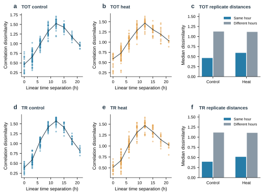

## S2 Fig. Regenerated multi-study trajectory atlas corresponding to the README benchmark gallery. PCA is fitted separately to each dataset-condition matrix after standardization of the 3,000 features selected by the registry pipeline. Panels show Arabidopsis diurnal control and heat, long-day and constant-light series, recovery control and heat, three rice genotypes, and tomato fruit development. Color progresses from earlier to later time within each panel; gray lines join chronological centroids without forced closure. The registry includes the 24-hour endpoint in the diurnal control (26 libraries), whereas the current main analysis uses hours below 24 (23 control libraries). These displays do not inherit historical detection verdicts or define the geometry used in Figures 2-6.

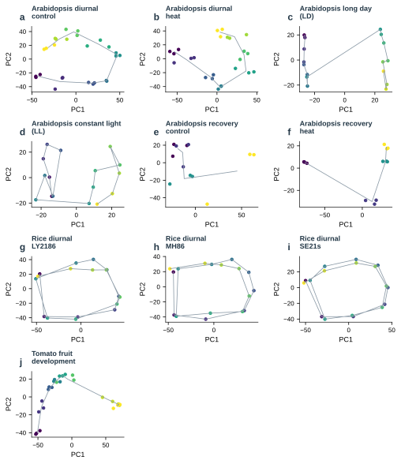

## S3 Fig. Historical v1 H1-reference comparison. Bars show the normalized longest H1 lifetime and red marks the recorded 95th percentile of the v1 reference for ten dataset-condition clouds. Values are redrawn directly from benchmark/results.json. They are retained as a historical diagnostic and are not recalculated v2 tail scores. Experimental expectations of recurrence are not biological ground-truth H1 labels.

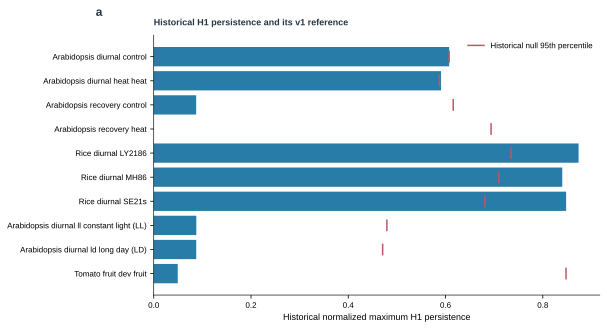

## S4 Fig. Historical v1 time-association diagnostics. Gray and blue points show correlations with linear time and the declared circular period; orange marks show the largest correlation over the archived period scan. The optimized values are descriptive. Historical permutation p-values are omitted, and this figure is not used to infer an independent cyclic coordinate. Source: benchmark/results.json.

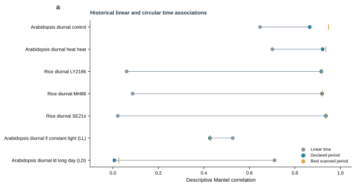

## S5 Fig. Historical label-withholding and sample-order diagnostics. (a) Circular Mantel correlations with recorded time labels and the median after label permutation, from the v1 side-information audit. (b) H1-walk cyclic succession and unique-sample coverage for the archived ordering experiments. Time labels were withheld from construction of the representative walk and used to evaluate its order. High succession on restricted support does not imply full-sample reconstruction. Numerical records are retained from benchmark/topology_without_labels.json; v1 detection labels and permutation significance claims are not transferred to v2.

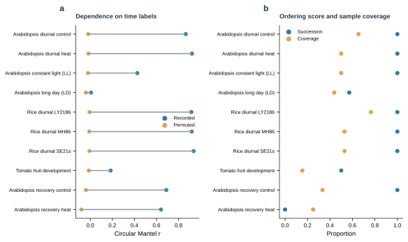

## S6 Fig. Historical signal-density and sampling-density sweep. The number of signal-carrying features is varied among 3,000 total features under six or sixteen distinct phases, using eight seeds per setting. (a) Median longest-to-second-longest H1-bar ratio. (b) Fraction of simulations reported as one cycle by the historical procedure. Values are redrawn from benchmark/cycle_counting_power.json. The bar-ratio criterion belongs to the earlier protocol and is not the v2 decision rule. This figure illustrates why relative signal strength and phase coverage must be reported.

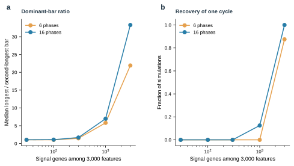

## S7 Fig. Complete historical baseline comparison. Sensitivity, specificity, and mean fitting time are redrawn for every method in benchmark/incremental_value.json on the archived corpus of 12 designated positive and 23 negative clouds. Error bars retain the recorded intervals; timings describe that original environment. Design-based positive labels in real data are not independently established topological ground truth. These historical ordering results do not estimate the operating characteristics of the current v2 H1 calibration.

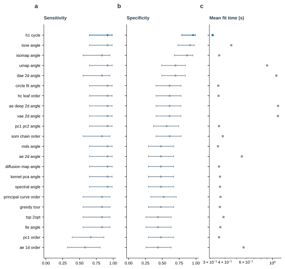

## S8 Fig. Historical expanded ordering benchmark. (a) False declarations among 240 simulated negative clouds, with recorded Wilson intervals and counts. (b) Proportions by negative generator family, each containing 60 clouds. (c) The fraction producing no order, producing an order below its score threshold, or making a false declaration. Forty positive ring clouds were also evaluated; all nine methods detected 40 of 40 in the archived benchmark. The record evaluates ordering against a phase-score reference and is separate from the v2 maximum-H1 reference test. Source: benchmark/increment_power.json.

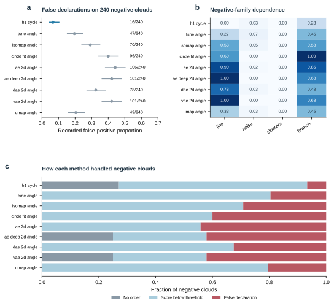

## S9 Fig. Feature-selection sensitivity in the GSE3431 v2 analysis. (a) Full-cloud candidate counts at 500, 1,000, and all 9,335 varying features, annotated with the final status. (b) Agreement of reduced-cloud counts with the full-cloud count; the dashed line is the fixed 0.75 threshold. The two selected-feature analyses remain unresolved, while the all-feature analysis returns stable zero detection. Source: benchmark/v2/real_validation.json.

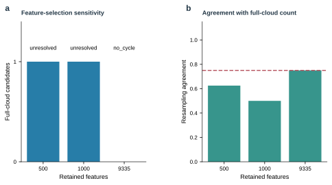

## S10 Fig. Numerical provenance and figure generation. Public accessions and source hashes connect to declared preprocessing, seeds, algorithm version, and numerical environment. Scored records preserve spectra, reference maxima, reduced-cloud counts, phase fits, and external gene matches. Figure-generation scripts consume these records. The supplement distinguishes regenerated source-matrix analyses from historical records redrawn without rerunning their inference.

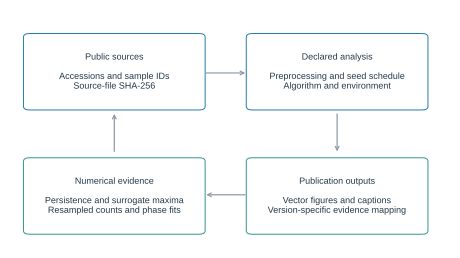

## S11 Fig. Sensitivity of external heat-response enrichment to the candidate cutoff. Odds ratios and 95% log-odds Wald intervals are shown for all four combinations of RNA fraction and external contrast at top 10%, 20%, and 30% absolute wrapped phase-difference cutoffs. The 20% threshold remains the primary analysis; alternatives are sensitivity checks, not a threshold-selection procedure. Benjamini-Hochberg q values across all 12 threshold-by-contrast tests in the heat-response family are reported in S4 Table.

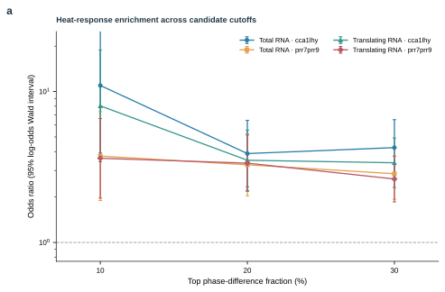
